# EventDrivenDotNet

Event-driven proof in .NET 11 and Kafka 4.4 for a plant scenario: about 500 machines stream readings while the central server is down for hours, and nothing may be lost or duplicated. Each of the five shops runs an active/standby pair of edge gateways that buffer on disk (if the active one dies, the standby takes over within seconds), a plant Kafka cluster rides out the outage, MirrorMaker 2 copies to a central cluster, and PostgreSQL stores each reading exactly once through a unique `(machine_id, seq)` key. Everything runs on one laptop with Docker Compose, with failure drills and a dashboard that proves zero loss and zero duplicates per machine.


| # | Document | What it holds |
| --- | --- | --- |
| 1 | [`docs/00-edd-demo-game-plan.md`](docs/00-edd-demo-game-plan.md) | Build spec for the demo: containers, contracts, services, drills, tests, build plan |
| 2 | [`docs/01-second-round-design-exercise.md`](docs/01-second-round-design-exercise.md) | The exercise brief and what it asks |
| 3 | [`docs/02-solution-design.md`](docs/02-solution-design.md) | The solution design: architecture, the twelve aspects, sizing, trade-offs |
| 4 | [`docs/03-implementation-plan.md`](docs/03-implementation-plan.md) | The task-by-task build plan |
| 5 | [`docs/04-build-progress.md`](docs/04-build-progress.md) | What is built, what is left, and the test counts |

## Run the demo

### Prerequisites

1. Docker Desktop with its memory set to 10 GB (the 21 containers' limits add up to about 7.3 GB).
2. `bash`, `curl` and `python3` for the drill and proof scripts.
3. The .NET SDK 11.0.100 and Bun 1.4.4 only to develop or run the tests.

### Start

From the repo root:

```sh
cd src/deployment
docker compose down -v                  # optional: a cold start from empty volumes
docker compose up -d --build --wait
```

Every service reports healthy or running, and `plant-topics` exits 0 after creating the topics. Open the control room at <http://localhost:3000> and give it a minute: five shops healthy, each tile naming its active gateway (`-a` or `-b`), about 500 readings per second.

### Drills

Run these from `src/deployment/` (the script works from anywhere). Each one prints the Docker command it runs, so the panel sees what is being broken.

| # | Command | What the panel sees |
| --- | --- | --- |
| 1 | `scripts/drill.sh central-down` | Central Kafka, the consumers and the database go Down. The plant keeps writing, and its alarms stay live. Mirror lag grows |
| 2 | `scripts/drill.sh central-up` | Mirror lag clears in seconds, then the database drains as its ETA counts down. The chart's gap fills in |
| 3 | `scripts/drill.sh failover BDY` | The shop's active gateway is killed; the standby takes over within about 15 s and the script prints how long it took. The killed one returns as the standby, with no second switch |
| 4 | `scripts/drill.sh kill-gateway BDY` | The active gateway is killed and restarted at once; the standby takes the lease and the restarted one rejoins as the standby. Sequence numbers continue and missed seconds are backfilled |
| 5 | `scripts/drill.sh lose-gateway-disk BDY` | The active gateway's disk is deleted; the rebuilt instance continues numbering from the plant log, with 0 gaps |
| 6 | `scripts/drill.sh kill-consumer 1` | The consumer group rebalances and the redelivered batch is absorbed |
| 7 | `scripts/drill.sh wan-cut` / `wan-restore`, `plant-down` / `plant-up` | Mirror lag, or the gateway buffers, grow and then clear |
| 8 | `scripts/drill.sh pause` / `resume` | Stops or restarts all simulated machines |

To show the alarm lane, inject an alarm during the drain: `../scripts/live/api.sh fault P1-MCH-C017 Vibration`. It reaches central within seconds.

After `central-up`, the store writers resume in about 45 s and the backlog drains in about as long as the outage lasted.

### The proof

```sh
scripts/drill.sh proof
```

It pauses the plant, waits until every buffer and lag is drained, then prints the reconciliation and exits 0 on PASS. PASS means, for every machine, generated equals stored, with 0 gaps, no stored sequence beyond what was generated (`over` 0) and 0 duplicate rows. The duplicates-absorbed count shows how many redeliveries the unique `(machine_id, seq)` key swallowed. While anything is still buffered or lagging, the verdict is WAIT, never PASS.

### Stop

```sh
docker compose down        # keeps the volumes; add -v to delete them
```

### More

1. [`src/scripts/README.md`](src/scripts/README.md): the developer and agent scripts (tests, API calls, screenshots).
2. [`docs/00-edd-demo-game-plan.md`](docs/00-edd-demo-game-plan.md) section 14 is the 12-minute demo script and section 10 lists every drill.
3. [`docs/01-second-round-design-exercise.md`](docs/01-second-round-design-exercise.md), [`docs/02-solution-design.md`](docs/02-solution-design.md), [`docs/03-implementation-plan.md`](docs/03-implementation-plan.md) and [`docs/04-build-progress.md`](docs/04-build-progress.md) hold the brief, the design, the plan and the progress.

## Backend codebase



Editable source: [`docs/diagrams/09-backend-codebase.html`](docs/diagrams/09-backend-codebase.html), generated by [`src/scripts/diagrams/gen_codebase.py`](src/scripts/diagrams/gen_codebase.py).

`src/backend/EventDrivenDesign.slnx` holds nine projects and two test projects. They follow Clean Architecture and DDD:

- **Hosts** are the executables. Each one starts at its `Program.cs`.
- **Adapters** do the I/O: Kafka settings, SQLite, PostgreSQL and HTTP plumbing.
- **Core** holds records, rules and the Result type, with no I/O.

References only point inward: a host references adapters and core, an adapter references core, and core references nothing outside itself.

Every project inherits the same settings from `Directory.Build.props`:

- .NET 11 and C# 15;
- nullable reference types on;
- warnings treated as errors;
- package versions managed centrally in `Directory.Packages.props`.

### Projects and layers

| # | Project | Layer | References | Files and the types they declare |
| --- | --- | --- | --- | --- |
| 1 | `EventDrivenDesign.Gateway` | Host (10 containers, `gateway-<shop>-a`/`-b`) | Contracts, Domain, Shared, Messaging, Persistence, Infrastructure | `Program.cs` (start point, the term), `Collector`, `CollectorService`, `Sender` + `SenderState`, `GatewayControl`, `GatewayLease` + `LeaseTerm` + `LeaseDecision`, `PlantLogReader` |
| 2 | `EventDrivenDesign.Consumer` | Host (`consumer-1`, `consumer-2`) | Contracts, Messaging, Persistence, Infrastructure | `Program.cs`, `ConsumerLoops`, `LoopService`, `BatchLoop<T>` + `ConsumerStats`, `RateCap` + `RateMeter`, `RecordValidation` |
| 3 | `EventDrivenDesign.Api` | Host (`api-1`, `api-2` behind nginx) | Contracts, Domain, Shared, Messaging, Persistence, Infrastructure | `Program.cs` (routes, `FaultRequest`), `Pollers`, `Snapshot` + `Stamped<T>` + `OffsetSample` + `DbSample`, `KafkaWatcher`, `OverviewBuilder`, `ApiRoutes` |
| 4 | `EventDrivenDesign.Infrastructure` | Adapter (ASP.NET Core) | Contracts, Shared | `HostingExtensions`, `GlobalExceptionHandler : IExceptionHandler`, `ResultHttpExtensions`, `ProcessSampler` |
| 5 | `EventDrivenDesign.Messaging` | Adapter (Confluent.Kafka) | Contracts | `KafkaConfigs` (Producer, StoreWriter, Lease, Tail, Admin), `CloudEvents`, `Retry` |
| 6 | `EventDrivenDesign.Persistence` | Adapter (Microsoft.Data.Sqlite, Npgsql) | Contracts, Domain | `GatewayBuffer` + `OutboxRow`, `MachineState`, `LogPosition`, `TickBatch`, `BufferStats`, `Lane`; `CentralStore` + `RejectedRecord`; `CentralQueries` |
| 7 | `EventDrivenDesign.Domain` | Core | Contracts | `MachineCatalog` + `MachineType`, `MachineInfo`; `Signals` + `SignalSpec`; `MachineSimulator` + `SimTick`, `AlarmEvent`; `Proof` + `ProgressRow` |
| 8 | `EventDrivenDesign.Contracts` | Core | none | `MachineReading`, `MachineAlarm`, `AlarmKind`; `union GatewayCommand` (`Pause`, `Resume`, `InjectFault`); `closed record ServiceHealth` (`Healthy`, `Degraded`, `Down`); `GatewayMetrics`, `ConsumerMetrics`, `ProcessStats`; the API models; `TopicNames`; `Json` (source-generated) |
| 9 | `EventDrivenDesign.Shared` | Core | none | `Result`, `Result<T>` (record structs with `Success`, `Failure`, `Match`), `Error(Code, Message, Kind)`, `ErrorKind` (`Invalid`, `NotFound`, `Unavailable`) |
| 10 | `tests/EventDrivenDesign.Tests` | Unit tests (170) | every project | xUnit v3, AwesomeAssertions, `FakeTimeProvider`; 19 test files |
| 11 | `tests/EventDrivenDesign.IntegrationTests` | Integration tests (19) | Gateway, Messaging, Persistence | Testcontainers Kafka and PostgreSQL: `CentralStore`, `CentralQueries`, `Sender`, `PlantLogReader`, `GatewayLease` |

### From start point to end point

| # | Flow | Path through the code |
| --- | --- | --- |
| 1 | A reading | `CollectorService` ticks every second → `Collector.Tick` (seq + 1 per machine) → `GatewayBuffer.WriteTickAsync` (outbox, one SQLite transaction) → `Sender.RunAsync`: `ReadOldest` → produce to `machine.readings` → `DeleteAsync` after the ack → MirrorMaker 2 → `plant1.machine.readings` → `BatchLoop<MachineReading>.Run` → `CentralStore.InsertReadingsAsync` → table `readings` → `CentralQueries` → `/api/overview`, `/api/chart`, `/api/reconciliation` |
| 2 | An alarm | `MachineSimulator.Next` raises an `AlarmEvent` → the outbox's alarm lane, which `Sender` reads first → `machine.alarms` → `plant1.machine.alarms` → `CentralStore.InsertAlarmsAsync` → table `alarms` → `/api/alarms` |
| 3 | Pause or resume | `POST /api/plant/pause` → `FanOut` → `POST /control` on all 10 gateways → `GatewayControl.ApplyAsync` → `GatewayBuffer.SetPausedAsync` → `202`, or ProblemDetails naming the gateways not reached |
| 4 | A fault | `POST /api/machines/{machineId}/faults` → `ApiRoutes.GatewayFor` (the shop's active gateway) → `POST /control` with `InjectFault` → `Collector.InjectFault` → the next ticks breach a threshold and raise an alarm |
| 5 | A gateway failover | The lease partition moves → `GatewayLease` stops the old term (collector stopped, sender drained) → the new holder fences, runs `PlantLogReader.ReconcileBufferAsync`, `Collector.Resume`, `MarkActive`, `CollectorService` (backfill first) and `Sender.RunAsync` |
| 6 | The proof | `GET /api/reconciliation` → `Pollers.RefreshDbAsync` → `OverviewBuilder.Reconcile` → `Proof.Reconcile` per machine → PASS only when paused, drained and 0 missing, 0 gaps, 0 over |

### HTTP endpoints

| # | Host | Route | Handler | Returns |
| --- | --- | --- | --- | --- |
| 1 | Api | `GET /api/overview` | `OverviewBuilder.Build(Snapshot)` | `Overview`: gateway, cluster, consumer and database tiles, rates, ETA |
| 2 | Api | `GET /api/reconciliation[?full=true]` | `OverviewBuilder.Reconcile`, `CentralQueries.DuplicateRowsAsync` when `full` | `Reconciliation` with `MachineProof[]`, verdict PASS, WAIT or FAIL |
| 3 | Api | `GET /api/chart?minutes=10` | `CentralQueries.ChartAsync` | `Chart` with `ChartPoint[]`, by device time |
| 4 | Api | `GET /api/alarms` | `CentralQueries.RecentAlarmsAsync` | `AlarmView[]` with latency |
| 5 | Api | `POST /api/plant/pause`, `/api/plant/resume` | `FanOut(GatewayCommand)` | `202`, or `503` ProblemDetails |
| 6 | Api | `POST /api/machines/{machineId}/faults` | `ApiRoutes.GatewayFor` → gateway `/control` | `202`, `400`, `404` or `503` |
| 7 | Gateway | `GET /metrics`, `POST /control`, `GET /healthz` | lambdas over `Collector`, `GatewayBuffer`, `Sender`; `GatewayControl.ApplyAsync` | `GatewayMetrics`; `Result` → `202` or ProblemDetails |
| 8 | Consumer | `GET /metrics`, `GET /healthz` | `ConsumerStats` | `ConsumerMetrics` |

Errors are values, not exceptions:

- Handlers return `Result`, and `ResultHttpExtensions.ToHttpResult` maps `ErrorKind` to 400, 404 or 503 ProblemDetails, with `title` = the error code and `detail` = its message.
- A query against a database that is down returns `api.database.unavailable` after 2 s. The full duplicate scan gets 60 s.
- Anything unexpected reaches `GlobalExceptionHandler` and becomes a 500.

### Events and stores

| # | Store | Written by (create, update, delete) | Read by |
| --- | --- | --- | --- |
| 1 | Kafka `machine.readings` (12 partitions, 8 h) and `machine.alarms` (3 partitions, kept for good), key `machine_id`, CloudEvents headers | `Sender` (idempotent producer, `acks=all`) | MirrorMaker 2; `PlantLogReader` (rebuilds numbering); `KafkaWatcher` (plant tail) |
| 2 | Kafka `gateway.lease.<shop>` (1 partition, never written) | nobody | `GatewayLease`: whoever is assigned the partition is the active gateway |
| 3 | Kafka `plant1.machine.readings`, `plant1.machine.alarms` (central) | MirrorMaker 2 | `BatchLoop<T>` (groups `central-readings`, `central-alarms`); `KafkaWatcher` (lag) |
| 4 | SQLite `outbox` (one `buffer.db` per gateway) | `WriteTickAsync` inserts; rows are never updated; `DeleteAsync` after the ack, `ReconcileAsync` for rows the log already holds | `ReadOldest`, `Stats` |
| 5 | SQLite `machine_state`, `gateway_state` | `WriteTickAsync` (upsert), `ReconcileAsync`, `SetPausedAsync` | `LoadState`, `LoadPaused` |
| 6 | PostgreSQL `readings` PK `(machine_id, seq)`, `alarms` PK `(machine_id, alarm_seq)` | `CentralStore`: `INSERT … ON CONFLICT DO NOTHING`; never updated or deleted | `CentralQueries.ChartAsync`, `RecentAlarmsAsync`, `DuplicateRowsAsync` |
| 7 | PostgreSQL `machine_progress`, `ingest_totals` | `CentralStore`, upserted in the same transaction as the rows | `CentralQueries.ProgressAsync`, `TotalsAsync` |
| 8 | PostgreSQL `rejected_records` PK `(topic, kafka_partition, kafka_offset)` | `CentralStore`, for records `RecordValidation` refuses | `psql`; the consumer counts rejects in `/metrics` |

### Idempotency, hop by hop

| # | Repeat that can happen | What makes it harmless | Code |
| --- | --- | --- | --- |
| 1 | History re-read after a restart | Backfill skips samples at or before `last_device_time_ms` | `Collector.Backfill` |
| 2 | Pause, resume or a fault sent twice | A persisted flag; a fault on a faulted signal is ignored | `GatewayControl.ApplyAsync`, `MachineSimulator.InjectFault` |
| 3 | Producer retry inside one session | Idempotent producer, `acks=all` | `KafkaConfigs.Producer` |
| 4 | Resend after a gateway restart | `(machine_id, seq)` primary key, `ON CONFLICT DO NOTHING` | `CentralStore.InsertReadingsAsync` |
| 5 | MirrorMaker 2 copies again after a restart | The same key | `CentralStore` |
| 6 | A store writer dies after its commit, before its offset | The same key, with the counters in the same transaction | `BatchLoop<T>.Run`, `CentralStore` |
| 7 | A malformed record delivered twice | `rejected_records` keyed by `(topic, partition, offset)` | `RecordValidation`, `CentralStore` |
| 8 | Two gateways after a lost lease session | A new term fences the old sender and reconciles from the log before it numbers | `GatewayLease`, `PlantLogReader` |

## Frontend codebase



Editable source: [`docs/diagrams/10-frontend-codebase.html`](docs/diagrams/10-frontend-codebase.html), generated by [`src/scripts/diagrams/gen_codebase.py`](src/scripts/diagrams/gen_codebase.py).

The dashboard lives in `src/frontend`. It uses React 19, TypeScript 7 (strict, `tsc -b`), Vite 8, Tailwind 4, TanStack React Query 5 and Recharts 3, and is built and tested with Bun 1.4.4.

- **Build and serve:** the Dockerfile's `web` stage builds `dist/`, and the `dashboard` stage serves it from nginx on port 3000.
- **Routing:** nginx sends `/api/` to `api-1` and `api-2` (with `ip_hash`, a passive health check and retry on the next API), and every other path to `index.html`.
- **Data flow:** `api.ts` is the only file that calls the backend. Panels receive their data as props and format it with the pure functions in `format.ts`.

### Files

| # | File | Kind | Exports | Role |
| --- | --- | --- | --- | --- |
| 1 | `index.html` | Start point | none | `<div id="root">` and `<script type="module" src="/src/main.tsx">` |
| 2 | `src/main.tsx` | Bootstrap | none | `createRoot` → `StrictMode` → `QueryClientProvider` → `ErrorBoundary` → `App` |
| 3 | `src/App.tsx` | Shell | `App` | Runs the four polling queries, `useFullCheck` and `useNow`; shows the API-unreachable banner; puts each panel in its own `ErrorBoundary`, reset when its query updates |
| 4 | `src/api.ts` | Data layer | the types; `ApiError`; `useOverview`, `useReconciliation`, `useFullCheck`, `useChart`, `useAlarms`, `usePause`, `useResume`, `useInjectFault`; `pause`, `resume`, `injectFault` | Mirrors the C# contracts. `get<T>` and `post` over `fetch`; a non-2xx answer throws `ApiError(code, message)` from ProblemDetails |
| 5 | `src/format.ts` | Pure logic | `agoText`, `healthLabel`, `instanceLabel`, `isStale`, `formatSeconds`, `formatEta`, `formatInt`, `fillBuckets`, `mirrorHealth`, `shouldRequestFull`, `proofView`, `panelNote` | Every decision the panels make, unit-tested by `format.test.ts` (47 `bun test` tests) |
| 6 | `src/panels/PipelineStrip.tsx` | Component | `PipelineStrip({ overview, nowMs })` | Machines → Gateways ×5 → Plant Kafka → MirrorMaker 2 → Central Kafka → Consumers ×2 → Database, with a health badge each |
| 7 | `src/panels/BuffersLag.tsx` | Component | `BuffersLag({ overview })` | One tile per shop, naming its active gateway (`a` or `b`); buffered rows, oldest unsent age; mirror lag, consumer lag, drain ETA |
| 8 | `src/panels/ReadingsChart.tsx` | Component | `ReadingsChart({ chart, nowMs, note })` | Recharts bar chart of the last 10 minutes by device time; minutes past the watermark are provisional |
| 9 | `src/panels/ProofPanel.tsx` | Component | `ProofPanel({ proof, full, nowMs, note })` | Verdict, generated, stored, missing, gaps, duplicate rows (full check), duplicates absorbed, per-machine table |
| 10 | `src/panels/AlarmsPanel.tsx` | Component | `AlarmsPanel({ alarms, paused, note })` | Latest alarms and their latency; Pause, Resume and Inject fault buttons |
| 11 | `src/panels/ui.tsx` | UI kit | `Panel`, `HealthBadge`, `Stat`, `toneOf` | Shared panel frame, health badge and stat block |
| 12 | `src/ErrorBoundary.tsx` | Boundary | `ErrorBoundary` (class) | A panel that throws shows its own message; the others keep updating |
| 13 | `src/useNow.ts` | Hook | `useNow(intervalMs = 1000)` | A one-second clock for "ago" text and the stale check between polls |

### Queries, commands and routes

| # | Hook | Route (through nginx) | When | Used by |
| --- | --- | --- | --- | --- |
| 1 | `useOverview` | `GET /api/overview` | every 1 s | `PipelineStrip`, `BuffersLag`, the banner, `paused` |
| 2 | `useReconciliation` | `GET /api/reconciliation` | every 1 s | `ProofPanel` |
| 3 | `useFullCheck` | `GET /api/reconciliation?full=true` | on the button, and at most every 10 s while paused and drained | `ProofPanel` (duplicate rows) |
| 4 | `useChart` | `GET /api/chart?minutes=10` | every 1 s | `ReadingsChart` |
| 5 | `useAlarms` | `GET /api/alarms` | every 1 s | `AlarmsPanel` |
| 6 | `usePause`, `useResume` | `POST /api/plant/pause`, `/api/plant/resume` | on click; then every query is invalidated | `AlarmsPanel` |
| 7 | `useInjectFault` | `POST /api/machines/{machineId}/faults` | on click | `AlarmsPanel` |

Queries poll with `retry: false` and keep their last data on an error. A panel whose query fails says one of two things:

- "Not updating, showing the last data received.", if it had data before;
- "No data yet. … Retrying every second.", if it never had any. The reason comes from the ProblemDetails `detail`.

## Approach

| # | Approach | Role in this repo |
| --- | --- | --- |
| 1 | SDD (Specification-Driven Development) | Planning, research, analysis — specs, contracts, pitfalls and pros/cons written before any code |
| 2 | DDD (Domain-Driven Design) | Structuring and design — bounded contexts, domain events/entities, code and dependency structure |
| 3 | TDD (Test-Driven Development) | Real implementation, Red → Green → Refactor, block by block (xUnit.net v3) |
| 4 | BDD (Behavior-Driven Development) | End-to-end scenarios in Given/When/Then form (Playwright for .NET) |
| 5 | FDD (Feature-Driven Development) | Workflow discipline — pros/cons, timeline, effort/capacity, delivery per feature slice |

### How They Work Together

- DDD guides the architecture and models the business problem.
- SDD defines the high-level specifications and contracts of what features must do.
- TDD verifies the low-level implementation block-by-block to ensure every piece works reliably.

## Stack

| # | Area | Choice |
| --- | --- | --- |
| 1 | Event medium | Apache Kafka 4.4 (KRaft): a plant cluster and a central cluster, joined by MirrorMaker 2 |
| 2 | Edge | Ten .NET gateways, an active/standby pair per shop held by a Kafka consumer-group lease, each with a SQLite store-and-forward buffer (`synchronous=FULL`) |
| 3 | Store | PostgreSQL 18, primary key `(machine_id, seq)`, `INSERT … ON CONFLICT DO NOTHING` |
| 4 | Runtime | .NET 11, C# 15, pure C# dispatch (no MediatR) |
| 5 | Dashboard | React, Vite, TypeScript and Tailwind, built with Bun and served by nginx |
| 6 | Packaging | Docker Compose; Docker Official Images or Verified Publisher images, plus `apache/kafka` |
| 7 | Tests | xUnit.net v3 with Testcontainers; Playwright for .NET for end-to-end |

Process: SDD then TDD — each phase is specified (analysis, pitfalls, pros/cons) before code; every implementation step is red-green-refactor. License: [AGPL-3.0](LICENSE.md).
