# EventDrivenDotNet

Event-driven proof in .NET 11 and Kafka 4.4 for a plant scenario: about 500 machines stream readings while the central server is down for hours, and nothing may be lost or duplicated. Five edge gateways buffer on disk, a plant Kafka cluster rides out the outage, MirrorMaker 2 copies to a central cluster, and PostgreSQL stores each reading exactly once through a unique `(machine_id, seq)` key. Everything runs on one laptop with Docker Compose, with failure drills and a dashboard that proves zero loss and zero duplicates per machine.

| # | Document | What it holds |
| --- | --- | --- |
| 1 | [`docs/00-edd-demo-game-plan.md`](docs/00-edd-demo-game-plan.md) | Build spec for the demo: containers, contracts, services, drills, tests, build plan |
| 2 | [`docs/01-second-round-design-exercise.md`](docs/01-second-round-design-exercise.md) | The exercise brief and what it asks |
| 3 | [`docs/02-solution-design.md`](docs/02-solution-design.md) | The solution design: architecture, the twelve aspects, sizing, trade-offs |

## Approach

| # | Approach | Role in this repo |
| --- | --- | --- |
| 1 | SDD (Specification-Driven Development) | Planning, research, analysis — specs, contracts, pitfalls and pros/cons written before any code |
| 2 | DDD (Domain-Driven Design) | Structuring and design — bounded contexts, domain events/entities, code and dependency structure |
| 3 | TDD (Test-Driven Development) | Real implementation, Red → Green → Refactor, block by block (xUnit.net v3) |
| 4 | BDD (Behavior-Driven Development) | End-to-end scenarios in Given/When/Then form (Playwright for .NET) |
| 5 | FDD (Feature-Driven Development) | Workflow discipline — pros/cons, timeline, effort/capacity, delivery per feature slice |

### How They Work Together

- DDD guides the architecture and models the business problem.
- SDD defines the high-level specifications and contracts of what features must do.
- TDD verifies the low-level implementation block-by-block to ensure every piece works reliably.

## Stack

| # | Area | Choice |
| --- | --- | --- |
| 1 | Event medium | Apache Kafka 4.4 (KRaft): a plant cluster and a central cluster, joined by MirrorMaker 2 |
| 2 | Edge | Five .NET gateways, each with a SQLite store-and-forward buffer (`synchronous=FULL`) |
| 3 | Store | PostgreSQL 18, primary key `(machine_id, seq)`, `INSERT … ON CONFLICT DO NOTHING` |
| 4 | Runtime | .NET 11, C# 15, pure C# dispatch (no MediatR) |
| 5 | Dashboard | React, Vite, TypeScript and Tailwind, built with Bun and served by nginx |
| 6 | Packaging | Docker Compose; Docker Official Images or Verified Publisher images, plus `apache/kafka` |
| 7 | Tests | xUnit.net v3 with Testcontainers; Playwright for .NET for end-to-end |

Process: SDD then TDD — each phase is specified (analysis, pitfalls, pros/cons) before code; every implementation step is red-green-refactor. License: [AGPL-3.0](LICENSE.md).
