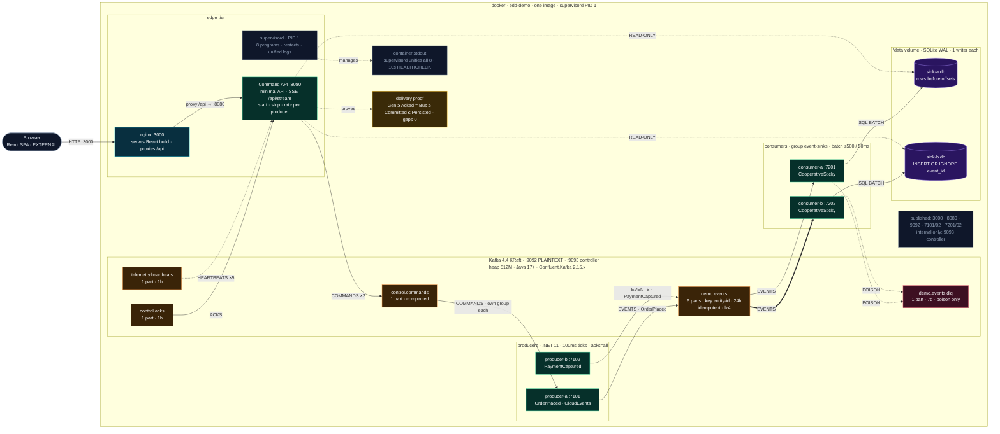

# EventDrivenDotNet

Production-style event-driven reference in .NET 11 and Kafka 4.4 (KRaft): two producers publish domain events, two consumers sink them into SQLite (WAL), with a command API, delivery-proof endpoint, and React dashboard — all in one Docker image.
Append-only event log, idempotent consumers with DLQ isolation, and end-to-end tests (xUnit.net v3 + Playwright) demonstrating exactly-once-effect semantics.

Full game plan (decisions, contracts, diagrams, build phases, demo script): [`docs/00-edd-demo-game-plan.md`](docs/00-edd-demo-game-plan.md).

## Approach

| # | Approach | Role in this repo |
| --- | --- | --- |
| 1 | SDD (Specification-Driven Development) | Planning, research, analysis — specs, contracts, pitfalls and pros/cons written before any code |
| 2 | DDD (Domain-Driven Design) | Structuring and design — bounded contexts, domain events/entities, code and dependency structure |
| 3 | TDD (Test-Driven Development) | Real implementation, Red → Green → Refactor, block by block (xUnit.net v3) |
| 4 | BDD (Behavior-Driven Development) | End-to-end scenarios in Given/When/Then form (Playwright for .NET) |
| 5 | FDD (Feature-Driven Development) | Workflow discipline — pros/cons, timeline, effort/capacity, delivery per feature slice |

### How They Work Together

- DDD guides the architecture and models the business problem.
- SDD defines the high-level specifications and contracts of what features must do.
- TDD verifies the low-level implementation block-by-block to ensure every piece works reliably.

## Stack

| Area | Choice |
| --- | --- |
| Event medium | Apache Kafka 4.4, single-node KRaft |
| Runtime | .NET 11, C# 15, pure C# dispatch (no MediatR) |
| Sink | SQLite in WAL mode, one file per consumer |
| Dashboard | React + Vite + TypeScript behind nginx |
| Packaging | One image, `supervisord` as PID 1 |
| Tests | xUnit.net v3; Playwright for .NET for end-to-end |

Process: SDD then TDD — each phase is specified (analysis, pitfalls, pros/cons) before code; every implementation step is red-green-refactor. License: [AGPL-3.0](LICENSE.md).
