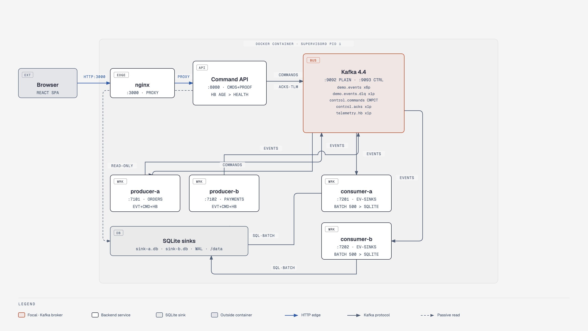

# EventDrivenDotNet

Interview demo: two producers, two consumers, one command API and one React dashboard. Kafka is the only channel between services, SQLite files are the sinks, and everything runs in a single Docker container.

Interactive version: [`docs/architecture.html`](docs/architecture.html). Full game plan (decisions, contracts, diagrams, build phases, demo script): [`docs/00-edd-demo-game-plan.md`](docs/00-edd-demo-game-plan.md).

| Area | Choice |
| --- | --- |
| Event medium | Apache Kafka 4.4, single-node KRaft |
| Runtime | .NET 11, C# 15, pure C# dispatch (no MediatR) |
| Sink | SQLite in WAL mode, one file per consumer |
| Dashboard | React + Vite + TypeScript behind nginx |
| Packaging | One image, `supervisord` as PID 1 |
| Tests | xUnit.net v3; Playwright for .NET for end-to-end |

Process: SDD then TDD — each phase is specified (analysis, pitfalls, pros/cons) before code; every implementation step is red-green-refactor. License: [AGPL-3.0](LICENSE.md).
