# Event-Driven Design Demo: Game Plan (.NET 11 / C# 15)

> Prepared by Tayyab Nazeer Shaikh at https://github.com/TayyabNazeerShaikh · First written 11 November 2026, rewritten 12 November 2026 for the plant exercise
>
> This is the build spec for the live demo that proves [doc 02, the solution design](02-solution-design.md). [Doc 01](01-second-round-design-exercise.md) records the exercise itself. Where this document and doc 02 differ, doc 02 wins.

The demo simulates 500 machines in five shops. Each shop's edge gateway buffers readings on disk and sends them to a plant Kafka broker. MirrorMaker 2 copies them to a central broker, and two consumers store them in PostgreSQL with a unique key. A control-room dashboard shows every buffer and lag, and proves after each failure drill that no reading was lost or duplicated. Everything runs on one laptop with Docker Compose.

---

## Contents

0. [Summary](#0-summary)
1. [What the demo must prove](#1-what-the-demo-must-prove)
2. [Stack and versions](#2-stack-and-versions)
3. [Containers, networks and memory](#3-containers-networks-and-memory)
4. [Topics and contracts](#4-topics-and-contracts)
5. [Gateway service](#5-gateway-service)
6. [MirrorMaker 2](#6-mirrormaker-2)
7. [Consumer service](#7-consumer-service)
8. [Control-room API](#8-control-room-api)
9. [Dashboard](#9-dashboard)
10. [Failure drills](#10-failure-drills)
11. [Testing strategy](#11-testing-strategy)
12. [Solution layout](#12-solution-layout)
13. [Build plan](#13-build-plan)
14. [Demo script and talking points](#14-demo-script-and-talking-points)
15. [Pure C#, no MediatR](#15-pure-c-no-mediatr)
16. [Risks and fallbacks](#16-risks-and-fallbacks)
17. [Sources](#17-sources)

---

## 0. Summary

| # | Area | Decision |
| --- | --- | --- |
| 1 | Topology | Two single-broker Kafka 4.4 clusters, one for the plant and one for central, joined by MirrorMaker 2 |
| 2 | Edge | Five shop gateways, each an active/standby pair of containers sharing a Kafka lease. The active one simulates the shop's 100 machines at 1 reading per second, with a SQLite store-and-forward buffer on its own named volume |
| 3 | Central store | PostgreSQL 18; primary key `(machine_id, seq)`; `INSERT … ON CONFLICT DO NOTHING` |
| 4 | Delivery | At-least-once on every hop; the database key is the only deduplication point |
| 5 | Packaging | Docker Compose: 21 containers on three networks, about 7.3 GB of memory limits (14 containers and 5.1 GB before the resilience tier) |
| 6 | Images | Docker Official Images or Verified Publisher images only, except `apache/kafka` (Kafka has no Docker Official Image) |
| 7 | Runtime and language | .NET 11 and C# 15; `EventDrivenDesign.*` projects only |
| 8 | Dashboard | React 19, Vite 8, TypeScript 7 and Tailwind 4, built with Bun and served by nginx on `:3000` |
| 9 | Tests | xUnit.net v3 for unit and integration tests (integration tests use Testcontainers); Playwright for .NET for end-to-end tests |
| 10 | The proof | After pausing the machines and draining every lag: generated = stored for each of the 500 machines, with 0 gaps; the duplicates-absorbed counter shows that duplicates arrived and were dropped |

---

## 1. What the demo must prove

| # | Email aspect ([doc 01 §2.3](01-second-round-design-exercise.md#23-the-twelve-aspects-to-cover)) | What the panel sees in the demo |
| --- | --- | --- |
| 1 | Data flow | Throughput at every stage, from the gateways to the database |
| 2 | Local buffering | Gateway buffer depth climbs when the plant broker stops; mirror lag climbs when central stops |
| 3 | Durability and recovery | A killed gateway restarts, and its sequences continue from disk |
| 4 | Kafka-like component | Two brokers and a mirror, and every drill recovers |
| 5 | Ack and retry | Rows leave a gateway only after acknowledgement; senders retry through outages |
| 6 | Duplicates | The duplicates-absorbed counter rises after the central-outage and consumer-crash drills, and the table still holds exactly one row per reading |
| 7 | Ordering | Per-machine sequences are contiguous after every drill (0 gaps) |
| 8 | Backlog and live data | A drain-time estimate counts down; an alarm injected during catch-up arrives in seconds; the chart's outage gap fills in by device time |
| 9 | Scale | 500 machines and 500 readings per second, with drain rates measured live |
| 10 | Failures | Six scripted drills (section 10) |
| 11 | Monitoring | Health, buffer depth, oldest unsent age, lag, freshness and alarms on one screen |
| 12 | Trade-offs | Each one is visible: single brokers, simulated machines, compressed time (doc 02 §7) |

Hard rules for the build:

1. **Data only travels through Kafka.** HTTP is used only by the control room: the browser calls the API, and the API reads metrics from the gateways and consumers and sends them pause, resume and fault commands.
2. **One deduplication point.** No code path writes a reading anywhere except through the `(machine_id, seq)` key.
3. **Approved images only.** Docker Official Images or Verified Publisher images, except `apache/kafka`.
4. **Memory.** At most 1 GB per container and about 10 GB in total.
5. **Naming.** Only `EventDrivenDesign.*` names.

---

## 2. Stack and versions

Versions were checked on 12 November 2026. Pin them exactly.

| # | Component | Version | Notes |
| --- | --- | --- | --- |
| 1 | .NET SDK | 11.0.100 | `global.json`; C# 15 is the default language for `net11.0` |
| 2 | `Confluent.Kafka` | 2.16.0 | It ships no `net11.0` build and runs through its `net10.0` build |
| 3 | `Microsoft.Data.Sqlite` | 11.0.0 | Gateway buffer |
| 4 | `Npgsql` | 10.0.3 | There is no 11.x yet; it runs on .NET 11 |
| 5 | `xunit.v3` | 4.0.3 | Runs on Microsoft.Testing.Platform (set in `global.json`) |
| 6 | `Testcontainers.Kafka`, `Testcontainers.PostgreSql` | 4.16.0 | Use `new KafkaBuilder("apache/kafka:4.4.0")`. Testcontainers' own CI only tests Kafka 4.1.1 |
| 7 | `Microsoft.Extensions.TimeProvider.Testing` | 11.0.0 | `FakeTimeProvider` for the simulator tests |
| 8 | `Microsoft.Playwright` | 1.64.1 | End-to-end tests; runs on the host |
| 8b | CSharpier | 1.4.0 | C# formatter: a local .NET tool pinned in `src/backend/dotnet-tools.json` (roll-forward on, so it runs on .NET 11). The versioned git hooks run it on every commit and block unformatted pushes |
| 8a | `AwesomeAssertions` | 9.6.0 | Test assertions in the `.Should()` style. The Apache-2.0 fork of FluentAssertions, chosen because FluentAssertions 8 needs a paid licence for commercial use |
| 9 | Bun | 1.4.4 | Frontend package manager and script runner; run Vite with `bunx --bun vite` |
| 10 | React | 19.3.1 | |
| 11 | Vite | 8.3.8 | |
| 12 | TypeScript | 7.0.2 | The Go-based compiler. Defaults to `types: []`, so list the types you need explicitly |
| 13 | Tailwind CSS | 4.3.5 | CSS-first: `@import "tailwindcss"` and `@theme` |
| 14 | `@tanstack/react-query` | 5.107.1 | Polls every second |
| 15 | Recharts | 3.10.1 | Needs `react-is` as a peer dependency |

| # | Image | Badge on Docker Hub | Used by |
| --- | --- | --- | --- |
| 1 | `mcr.microsoft.com/dotnet/sdk:11.0` | Verified Publisher (Microsoft) | Build stage |
| 2 | `mcr.microsoft.com/dotnet/aspnet:11.0` | Verified Publisher (Microsoft) | Gateway, consumer and API runtimes (Ubuntu 26.04 base) |
| 3 | `postgres:18.6-alpine` | Docker Official Image | `central-db` |
| 4 | `nginx:1.30-alpine-slim` | Docker Official Image | `dashboard` |
| 5 | `apache/kafka:4.4.0` | Sponsored OSS, published by the Apache Kafka project | `plant-kafka`, `central-kafka`, `mm2`, `plant-topics` |
| 6 | `oven/bun:1.4.4-alpine` | No badge; published by Oven, Bun's maker | Frontend build stage only; never shipped |
| 7 | `mcr.microsoft.com/playwright/dotnet:v1.64.1-noble` | Verified Publisher (Microsoft) | Optional CI runner for end-to-end tests. The tag must match the package version |

Kafka has no Docker Official Image (`library/kafka` does not exist). The verified alternatives are either too old (`ubuntu/kafka` stops at 4.1) or an undocumented vendor rebuild (`cleanstart/kafka`). `apache/kafka` comes from Kafka's own maintainers and includes MirrorMaker 2.

---

## 3. Containers, networks and memory


*Source: [08-demo-deployment.html](diagrams/08-demo-deployment.html)*

The table shows the stack once the resilience tier is built (doc 02 §4.3, "Fault tolerance and zero downtime"; doc 03 tasks R1–R4). The column "Tier" says which task adds a container. Before R3 each shop has one gateway, `gateway-<shop>`; before R4 there is one `mm2` and one `api`.

| # | Service | Image or project | Networks | Memory limit | Volume | Host port | Tier |
| --- | --- | --- | --- | --- | --- | --- | --- |
| 1 | `plant-kafka` | `apache/kafka:4.4.0` | plant | 1 GB | `plant-kafka-data` | 19092 | Must |
| 2 | `plant-topics` | `apache/kafka:4.4.0`, one-shot | plant | 512 MB (exits) | — | — | Must |
| 3–12 | `gateway-prs-a`, `gateway-prs-b`, `gateway-bdy-a`, `gateway-bdy-b`, `gateway-pnt-a`, `gateway-pnt-b`, `gateway-mch-a`, `gateway-mch-b`, `gateway-asm-a`, `gateway-asm-b`: one active/standby pair per shop | `EventDrivenDesign.Gateway` | plant | 256 MB each | `gateway-<shop>-a-data`, `gateway-<shop>-b-data` | — | Must (five), R3 (the other five) |
| 13–14 | `mm2-1`, `mm2-2`: one MirrorMaker 2 group in dedicated mode | `apache/kafka:4.4.0` running `connect-mirror-maker.sh` | plant, central | 768 MB each | — | — | Must (one), R4 (the second) |
| 15 | `central-kafka` | `apache/kafka:4.4.0` | central | 1 GB | `central-kafka-data` | 29092 | Must |
| 16 | `central-db` | `postgres:18.6-alpine` | central | 256 MB | `central-db-data` | 55432 | Must |
| 17–18 | `consumer-1`, `consumer-2` | `EventDrivenDesign.Consumer` | central | 256 MB each | — | — | Must |
| 19–20 | `api-1`, `api-2`: behind the dashboard's nginx | `EventDrivenDesign.Api` | plant, central, ops | 256 MB each | — | — | Must (one), R4 (the second) |
| 21 | `dashboard` | `nginx:1.30-alpine-slim` with the React build | ops | 64 MB | — | 3000 | Must |

| # | Stage | Containers | Running total of limits |
| --- | --- | --- | --- |
| 1 | Must tier | 14 | About 5.1 GB (5,184 MB) |
| 2 | R3: five standby gateways | +5 | +1,280 MB |
| 3 | R4: a second API and a second MirrorMaker 2 worker | +2 | +1,024 MB (256 + 768) |
| 4 | Whole stack | 21 | About 7.3 GB (7,488 MB) |

The one-shot `plant-topics` is not in the totals, because it exits before the rest starts. Set Docker Desktop's memory to 10 GB so containers can never eat into the 20 GB the host needs for its own work. Under memory pressure, stop the five standby gateways first: the plant keeps running on the active ones. Do that only when no failover is being demonstrated and no proof is running: a stopped standby cannot take over, and it cannot answer the proof's pause, so the verdict waits until it is back.

Memory settings that keep each container inside its limit:

| # | Container | Setting | Why |
| --- | --- | --- | --- |
| 1 | Kafka brokers | `KAFKA_HEAP_OPTS="-Xms512m -Xmx512m"` | The default heap is 1 GB, which leaves no room for page cache and metaspace inside a 1 GB limit |
| 2 | MirrorMaker 2 | `KAFKA_HEAP_OPTS="-Xms128m -Xmx384m"` | `connect-mirror-maker.sh` defaults to a 2 GB heap |
| 3 | .NET services | `DOTNET_gcServer=0` | Workstation GC; server GC reserves far more memory per core |
| 4 | Gateways | librdkafka `queue.buffering.max.kbytes=16384` | librdkafka's default send queue is 1 GiB of native memory, outside the GC's limit. Without a cap, an outage gets the gateway OOM-killed |
| 5 | Consumers | librdkafka `queued.max.messages.kbytes=16384` | The same issue on the fetch side |
| 6 | PostgreSQL | `-c shared_buffers=64MB -c max_connections=20` | Defaults assume a whole machine |
| 7 | Every service | `memswap_limit` equal to `mem_limit` | No swap; a container that exceeds its limit fails visibly (exit 137, `OOMKilled=true`) |

Start order uses `depends_on` with health checks: `plant-kafka` and `central-kafka` report healthy (`kafka-broker-api-versions.sh`), and `central-db` reports healthy (`pg_isready`). Then `plant-topics` runs once and exits, and the gateways, the MirrorMaker 2 workers, the consumers and the APIs start. librdkafka reconnects on its own, so the .NET services need no health checks of their own. The API watches them.

The broker environment is shown for `plant-kafka`; `central-kafka` is the same with its own names and ports:

```yaml
plant-kafka:
  image: apache/kafka:4.4.0
  environment:
    KAFKA_NODE_ID: 1
    KAFKA_PROCESS_ROLES: broker,controller
    KAFKA_LISTENERS: INTERNAL://:9092,CONTROLLER://:9093,HOST://:19092
    KAFKA_ADVERTISED_LISTENERS: INTERNAL://plant-kafka:9092,HOST://localhost:19092
    KAFKA_LISTENER_SECURITY_PROTOCOL_MAP: INTERNAL:PLAINTEXT,CONTROLLER:PLAINTEXT,HOST:PLAINTEXT
    KAFKA_INTER_BROKER_LISTENER_NAME: INTERNAL
    KAFKA_CONTROLLER_LISTENER_NAMES: CONTROLLER
    KAFKA_CONTROLLER_QUORUM_VOTERS: 1@plant-kafka:9093
    KAFKA_OFFSETS_TOPIC_REPLICATION_FACTOR: 1
    KAFKA_TRANSACTION_STATE_LOG_REPLICATION_FACTOR: 1
    KAFKA_TRANSACTION_STATE_LOG_MIN_ISR: 1
    KAFKA_GROUP_INITIAL_REBALANCE_DELAY_MS: 0
    KAFKA_AUTO_CREATE_TOPICS_ENABLE: "false"
    KAFKA_LOG_DIRS: /var/lib/kafka/data
    KAFKA_HEAP_OPTS: -Xms512m -Xmx512m
  volumes: [plant-kafka-data:/var/lib/kafka/data]
  mem_limit: 1g
  memswap_limit: 1g
  networks: [plant]
```

PostgreSQL 18 keeps its data under a version-specific directory, so mount the volume at `/var/lib/postgresql`, not `/var/lib/postgresql/data`.

---

## 4. Topics and contracts

| # | Topic | Cluster | Partitions | Retention (demo) | Written by | Read by |
| --- | --- | --- | --- | --- | --- | --- |
| 1 | `machine.readings` | plant | 12 | 3 h | Gateways | MirrorMaker 2, API (plant tail) |
| 2 | `machine.alarms` | plant | 3 | 3 h | Gateways | MirrorMaker 2, API (plant alarms view) |
| 3 | `plant1.machine.readings` | central | 12 | 3 h (copied from the source by MirrorMaker 2) | MirrorMaker 2 | Consumers (group `central-readings`), API (central tail) |
| 4 | `plant1.machine.alarms` | central | 3 | 3 h | MirrorMaker 2 | Consumers (group `central-alarms`) |
| 5 | `gateway.lease.<shop>` (`prs`, `bdy`, `pnt`, `mch`, `asm`; R3) | plant | 1 | 3 h | Nobody: it holds no data | The shop's gateway pair (group `gateway-lease-<shop>`): the member assigned its one partition is active |

`plant-topics` creates topics 1, 2 and 5 with `--if-not-exists`. MirrorMaker 2 creates topics 3 and 4 and its own internal topics on the central cluster. Three hours of retention covers the longest drill many times over: 500 records/s × about 250 B is about 450 MB per hour.

Record headers follow CloudEvents binary mode (doc 02 §3). The gateway builds the headers at send time from the buffer row, so they are never stored:

| # | Header | Value |
| --- | --- | --- |
| 1 | `ce_specversion` | `1.0` |
| 2 | `ce_id` | `{machine_id}-{seq}`, or `{machine_id}-a{alarm_seq}` for alarms |
| 3 | `ce_type` | `com.eventdrivendesign.machine.reading.v1`, or `com.eventdrivendesign.machine.alarm.v1` |
| 4 | `ce_source` | `/plant1/{shop}/gateway` |
| 5 | `ce_time` | Device time, RFC 3339 |

The record's key is `machine_id`, and its timestamp is the device time (`CreateTime`).

Contracts (`EventDrivenDesign.Contracts`, serialised by the source-generated `EventDrivenDesignJsonContext`):

```csharp
public sealed record MachineReading(
    string MachineId, string MachineType, string Shop, long Seq,
    DateTimeOffset DeviceTime, IReadOnlyDictionary<string, double> Signals);

public sealed record MachineAlarm(
    string MachineId, long AlarmSeq, long ReadingSeq, DateTimeOffset DeviceTime,
    AlarmKind Kind, string Severity, string? Signal, double? Value, double? Threshold);

public enum AlarmKind { Overheat, Vibration, Overload, EStop, LowBattery, OutOfBand, DataGap }

// Control-room commands to a gateway, over HTTP (section 8). Exhaustive switch at the one call site.
public sealed record Pause;
public sealed record Resume;
public sealed record InjectFault(string MachineId, AlarmKind Kind);
public union GatewayCommand(Pause, Resume, InjectFault);

public sealed record GatewayMetrics(
    string GatewayId, string Shop, string State, bool Paused, int Machines,
    long Generated, long BufferedReadings, long BufferedAlarms, long OldestUnsentAgeMs,
    double SentPerSecond, long SendErrors, long BufferBytes,
    IReadOnlyDictionary<string, long> LastSeqByMachine, ProcessStats Process,
    string Role);  // R3: "active" or "standby"; GatewayId is the instance, e.g. gateway-bdy-a

public sealed record ConsumerMetrics(
    string ConsumerId, int[] AssignedPartitions, double ConsumedPerSecond,
    double InsertedPerSecond, long Received, long Inserted, long Rejected,
    long LastBatchMs, ProcessStats Process);

public sealed record ProcessStats(double CpuPercent, long WorkingSetBytes, long GcHeapBytes);

// Source health as the API sees it (section 8). Closed, so a switch over it needs no default arm.
[JsonPolymorphic(TypeDiscriminatorPropertyName = "$type")]
[JsonDerivedType(typeof(Healthy), "Healthy")]
[JsonDerivedType(typeof(Degraded), "Degraded")]
[JsonDerivedType(typeof(Down), "Down")]
public closed record class ServiceHealth;
public sealed record class Healthy : ServiceHealth;
public sealed record class Degraded(string Reason) : ServiceHealth;
public sealed record class Down(DateTimeOffset LastSeen) : ServiceHealth;
```

`GatewayCommand` and `ServiceHealth` travel as JSON with a `$type` discriminator, and a contract test pins each shape.

---

## 5. Gateway service

`EventDrivenDesign.Gateway` is a worker host with a small Kestrel endpoint. It plays one shop's edge gateway: a collector that simulates the shop's machines, a SQLite buffer, and a sender.



*Source: [02-edge-gateway.html](diagrams/02-edge-gateway.html)*

### Machines

Machine IDs are `P1-{SHOP}-{type letter}{nnn}`, numbered 001 to 100 within each shop, for example `P1-BDY-W042`. Type letters: S stamping press, W weld robot, B paint booth, C CNC machine, V conveyor, A AGV.

| # | Shop (gateway) | Machines |
| --- | --- | --- |
| 1 | Press (`PRS`) | 30 stamping presses, 50 conveyors, 20 AGVs |
| 2 | Body (`BDY`) | 80 weld robots, 10 conveyors, 10 AGVs |
| 3 | Paint (`PNT`) | 40 paint booths, 50 conveyors, 10 AGVs |
| 4 | Machining (`MCH`) | 70 CNC machines, 20 conveyors, 10 AGVs |
| 5 | Assembly (`ASM`) | 60 conveyors, 40 AGVs |

| # | Machine type | Signals: normal band | Alarm when |
| --- | --- | --- | --- |
| 1 | Stamping press | `tonnage_t` 600–800, `strokes_per_min` 16–20, `die_temp_c` 40–60 | Tonnage over 900 (Overload); die over 80 °C (Overheat) |
| 2 | Weld robot | `weld_current_ka` 8–15, `weld_time_ms` 100–330, `motor_temp_c` 40–70 | Current outside 7–16 kA (OutOfBand); motor over 85 °C (Overheat) |
| 3 | Paint booth | `air_temp_c` 21–24, `humidity_pct` 40–60, `airflow_m_s` 0.3–0.5 | Temperature outside 20–25 °C or humidity outside 35–65% (OutOfBand) |
| 4 | CNC machine | `spindle_rpm` 6,000–12,000, `vibration_mm_s` 0.5–2.8, `load_pct` 30–80 | Vibration over 4.5 mm/s, ISO 20816 zone D (Vibration); load over 95% (Overload) |
| 5 | Conveyor | `speed_m_min` 8–12, `motor_current_a` 10–20, `vibration_mm_s` 0.5–2.8 | Current over 25 A (Overload); vibration over 4.5 mm/s (Vibration) |
| 6 | AGV | `battery_pct` 20–100, `velocity_m_s` 0–2, `e_stop` 0 or 1 | Battery under 15% (LowBattery); `e_stop` = 1 (EStop) |

### Collector (simulator)

- **Tick.** One `PeriodicTimer(TimeSpan.FromSeconds(1), timeProvider)` drives all 100 machines. Each machine's device time is the tick time plus a fixed offset (machine index × 10 ms), so timestamps spread realistically.
- **Signals.** Each signal follows Ornstein-Uhlenbeck noise around the middle of its normal band, plus a slow random-walk wear drift on vibration and temperature. The model lives in `EventDrivenDesign.Domain`, is pure, and is seeded per machine from `Gateway__Seed + machine index`. Never seed from `string.GetHashCode()`, which is randomised per process.
- **Faults.** Random faults occur at `Gateway__FaultsPerMinute` (default 0.5 per gateway), or on demand with `InjectFault`. A fault pushes the machine's relevant signal past its threshold for 10 ticks. When the signal crosses the threshold on the way up, the collector emits one `MachineAlarm` with the machine's next `alarm_seq`.
- **One transaction per tick.** The tick's readings, any alarms and the updated `machine_state` rows go into the buffer as one SQLite transaction.
- **Backfill on restart.** The collector keeps each machine's last device time from the resume state and updates it on every tick. For each machine it has numbered, it regenerates the seconds it missed since that time with their original device times, up to `Gateway__HistoryDepthSeconds` (default 600). This emulates re-reading the machine controller's history. A larger gap produces one `DataGap` alarm covering the missing range, so the loss is explicit. Backfill commits in chunks of 60 seconds.
- **Rebuild on a new file.** If the buffer file is new (`machine_state` is empty), the gateway reads the plant topics before its first tick. For each of its 100 machines, the newest reading gives `last_seq` and `last_device_time_ms`, and the newest alarm gives `last_alarm_seq`. It scans each partition backwards from the end in doubling chunks until every machine is found or the log start is reached; a machine with no record starts at 1. The reading pair `(last_seq, last_device_time_ms)` comes from whichever side is further ahead, never a maximum per field; `last_alarm_seq` is the larger of the two on its own. While plant Kafka is unreachable it retries and numbers nothing. Doc 02 §4.3 says why. In a pair (R3), every assignment after a lost session starts a new term: the sender is fenced, then the same reconcile and backfill run before numbering resumes, because the partner may have numbered further. A standby reconciles against the log on start and every 10 s and numbers nothing.
- **Pause.** Pause stops the tick but not the sender. The paused flag is persisted, so a restart while paused stays paused and never backfills the paused time.

### Buffer

The schema and the five rules are in doc 02 §4.2: WAL, `synchronous=FULL`, incremental auto-vacuum, an `outbox` table with an alarm lane and a reading lane, and a `machine_state` table. Add a one-row `gateway_state (paused INTEGER NOT NULL)` table.

The buffer is a **transactional outbox**: a reading, its sequence number and the machine's state commit in one SQLite transaction, and the sender relays rows to Kafka and deletes them only after the broker's acknowledgement.

- **One writer.** A single long-lived connection on a dedicated thread owns every write. The collector and the sender submit `WriteTick` and `DeleteAcked` operations through a bounded `Channel` with `FullMode.Wait`, and the writer thread uses the synchronous ADO.NET API.
- **Reads.** The sender reads on its own connection; WAL lets reads run alongside writes.
- **File location.** `Buffer__Path=/data/buffer.db` on the gateway's named volume. Never use a bind mount: SQLite locking on host bind mounts is unreliable on macOS.

### Sender

```text
loop:
  rows = SELECT id, lane, machine_id, seq, device_time_ms, payload
         FROM outbox ORDER BY lane, id LIMIT @batch          -- alarms first, oldest first
  for each row: producer.Produce(topic(lane), key = machine_id,
                timestamp = device_time_ms (CreateTime), headers = ce_*, value = payload)
  wait for every delivery report (or message.timeout.ms)
  DeleteAcked(ids that reported success)                     -- through the writer channel
  if any failed: state = Retrying; backoff 0.1 s × 2^n up to 30 s, full jitter; continue
  state = oldest unsent age > 5 s ? CatchingUp : Sending
```

| # | librdkafka setting | Value | Why |
| --- | --- | --- | --- |
| 1 | `acks` | `all` | Safe point 2 in doc 02 §4.1 |
| 2 | `enable.idempotence` | `true` | Removes duplicates from client retries within a session |
| 3 | `linger.ms` | `20` | Batches records without adding visible latency |
| 4 | `compression.type` | `lz4` | Cheap on CPU; shrinks JSON several-fold |
| 5 | `message.timeout.ms` | `30000` | Gives up quickly and hands the row back to the sender loop, which owns long retries |
| 6 | `queue.buffering.max.kbytes` | `16384` | Caps native memory (section 3) |
| 7 | `queue.buffering.max.messages` | `20000` | Same reason |

`@batch` is 1,000 rows while sending live and 5,000 while catching up. The states (Starting, Sending, Catching up, Retrying, Stopping) are in [diagram 6](diagrams/06-sender-states.svg). On shutdown, the sender stops reading, waits up to 10 s for in-flight reports, deletes what was acknowledged, and leaves the rest on disk. A lease revocation runs the same bounded drain while the broker still acknowledges; a lost session cancels the sender at once, and the collector keeps writing to disk. The producer is the host singleton, so its queue and in-flight reports outlive a term.

### Endpoints and configuration

| # | Method | Path | Does |
| --- | --- | --- | --- |
| 1 | GET | `/metrics` | `GatewayMetrics` as JSON |
| 2 | POST | `/control` | A `GatewayCommand` as JSON → 202, or 400 for a fault that doesn't apply to that machine type |
| 3 | GET | `/healthz` | Liveness |

| # | Setting | Example |
| --- | --- | --- |
| 1 | `Gateway__Shop` | `BDY` |
| 2 | `Gateway__Plant` | `P1` |
| 3 | `Gateway__Seed` | `2000` (each gateway gets a distinct seed) |
| 4 | `Gateway__FaultsPerMinute` | `0.5` |
| 5 | `Gateway__HistoryDepthSeconds` | `600` |
| 6 | `Kafka__BootstrapServers` | `plant-kafka:9092` |
| 7 | `Buffer__Path` | `/data/buffer.db` |
| 8 | `ASPNETCORE_HTTP_PORTS` | `8080` |
| 9 | `Gateway__Instance` | `gateway-bdy-a` (R3): the Compose service name. It is the lease's `group.instance.id` and the `GatewayId` in `/metrics` |

Compose declares the gateways once with a YAML anchor and overrides `Gateway__Shop`, `Gateway__Instance`, `Gateway__Seed` and the volume for each. After R3 there are ten, `gateway-<shop>-a` and `gateway-<shop>-b`. Both instances of a shop get the shop's seed, because both read the same machines.

---

## 6. MirrorMaker 2

`mm2` runs `/opt/kafka/bin/connect-mirror-maker.sh /etc/mm2/mm2.properties` from the `apache/kafka:4.4.0` image. The lighter `apache/kafka-native` image cannot run MirrorMaker 2.

```properties
clusters = plant1, central
plant1.bootstrap.servers = plant-kafka:9092
central.bootstrap.servers = central-kafka:9092

plant1->central.enabled = true
plant1->central.topics = machine\\.readings, machine\\.alarms
central->plant1.enabled = false

# write nothing back to the plant: offset syncs live on the target
offset-syncs.topic.location = target
emit.checkpoints.enabled = false
sync.group.offsets.enabled = false

tasks.max = 2
refresh.topics.interval.seconds = 30

# single-broker demo clusters
replication.factor = 1
checkpoints.topic.replication.factor = 1
heartbeats.topic.replication.factor = 1
offset-syncs.topic.replication.factor = 1
offset.storage.replication.factor = 1
status.storage.replication.factor = 1
config.storage.replication.factor = 1

# never skip a record silently (this is the default; stated so nobody changes it)
errors.tolerance = none

# R4: two dedicated workers. They forward task configs to the leader over internal REST (KIP-710)
dedicated.mode.enable.internal.rest = true
# hand a dead worker's tasks to the survivor after 10 s, not Connect's default 5 minutes
plant1->central.scheduled.rebalance.max.delay.ms = 10000
```

MirrorMaker 2 keeps each record's partition, key, timestamp and headers, and the default replication policy adds the `plant1.` prefix. It is at-least-once: after a restart it copies again from its last saved source offset, and the database key absorbs the repeats. The demo runs two workers, `mm2-1` and `mm2-2` (R4), with the same file. They form one group through the flow's internal topics on the central cluster and share its tasks. Each container sets `hostname` to its service name, so the REST address it advertises resolves on the Docker networks. In production, also add `replication.factor = 3`.

---

## 7. Consumer service

`EventDrivenDesign.Consumer` runs two consume loops in one process:

| # | Loop | Group | Subscription | Batch |
| --- | --- | --- | --- | --- |
| 1 | Readings | `central-readings` | `^plant[0-9]+\.machine\.readings$` | Up to 5,000 records or 200 ms |
| 2 | Alarms | `central-alarms` | `^plant[0-9]+\.machine\.alarms$` | Up to 100 records or 50 ms |

| # | librdkafka setting | Value |
| --- | --- | --- |
| 1 | `enable.auto.commit` | `true` |
| 2 | `enable.auto.offset.store` | `false`: offsets are stored only after the database commit |
| 3 | `auto.offset.reset` | `earliest` |
| 4 | `partition.assignment.strategy` | `cooperative-sticky` |
| 5 | `queued.max.messages.kbytes` | `16384` |

For each batch:

1. Parse every record with the source-generated JSON context. Records that fail to parse become `rejected_records` rows.
2. In one transaction, run the readings insert with the progress update (below), add to `ingest_totals`, and insert any rejected rows.
3. Commit, then call `StoreOffset` for the last record of each partition. Auto-commit sends the stored offsets every 5 seconds, and the revoke handler commits them synchronously.
4. If the database fails, retry the same batch with backoff and store no offsets.

**Drain cap.** The readings loop inserts at most `Consumer__MaxRowsPerSecond` rows per second (default 1,000 per writer, so the two writers together drain at 2,000 per second, four times the live rate). Measured in the Task 16 rehearsal: the writers resume about 45 s after `central-up`, then insert 1,200 to 1,500 rows per second together, so a 2.5-minute outage drains in about 2 minutes 15 seconds. That is long enough for the panel to watch the drain-time estimate and inject an alarm. `0` removes the cap, to measure the database's real capacity. The alarms loop is never capped.

```sql
WITH ins AS (
  INSERT INTO readings (machine_id, seq, device_time, machine_type, shop, signals)
  SELECT * FROM unnest(@machine_ids::text[], @seqs::bigint[], @device_times::timestamptz[],
                       @types::text[], @shops::text[], @signals::jsonb[])
  ON CONFLICT (machine_id, seq) DO NOTHING
  RETURNING machine_id, seq, device_time
), progress AS (
  INSERT INTO machine_progress AS p (machine_id, stored, max_seq, max_device_time)
  SELECT machine_id, count(*), max(seq), max(device_time) FROM ins GROUP BY machine_id
  ON CONFLICT (machine_id) DO UPDATE
    SET stored          = p.stored + EXCLUDED.stored,
        max_seq         = GREATEST(p.max_seq, EXCLUDED.max_seq),
        max_device_time = GREATEST(p.max_device_time, EXCLUDED.max_device_time)
)
SELECT count(*) FROM ins;   -- inserted; batch size − inserted = duplicates absorbed
```

A machine's key always maps to one partition, so only one consumer updates a given `machine_progress` row at a time. During a rebalance the row lock serialises any overlap.

Schema (`src/deployment/postgres/01-schema.sql`, mounted into `/docker-entrypoint-initdb.d/`; the integration tests run the same file):

```sql
CREATE TABLE readings (
  machine_id   text        NOT NULL,
  seq          bigint      NOT NULL,
  device_time  timestamptz NOT NULL,
  machine_type text        NOT NULL,
  shop         text        NOT NULL,
  signals      jsonb       NOT NULL,
  stored_at    timestamptz NOT NULL DEFAULT now(),
  PRIMARY KEY (machine_id, seq)
);
CREATE INDEX ix_readings_device_time ON readings (device_time);

CREATE TABLE alarms (
  machine_id  text             NOT NULL,
  alarm_seq   bigint           NOT NULL,
  reading_seq bigint           NOT NULL,
  device_time timestamptz      NOT NULL,
  kind        text             NOT NULL,
  severity    text             NOT NULL,
  signal      text,
  value       double precision,
  threshold   double precision,
  stored_at   timestamptz      NOT NULL DEFAULT now(),
  PRIMARY KEY (machine_id, alarm_seq)
);

CREATE TABLE machine_progress (
  machine_id      text        PRIMARY KEY,
  stored          bigint      NOT NULL,
  max_seq         bigint      NOT NULL,
  max_device_time timestamptz NOT NULL
);

CREATE TABLE ingest_totals (
  stream    text   NOT NULL,          -- 'readings' or 'alarms'
  writer_id text   NOT NULL,          -- consumer-1, consumer-2: no shared hot row
  received  bigint NOT NULL DEFAULT 0,
  inserted  bigint NOT NULL DEFAULT 0,
  PRIMARY KEY (stream, writer_id)
);

CREATE TABLE rejected_records (
  topic           text        NOT NULL,
  kafka_partition int         NOT NULL,
  kafka_offset    bigint      NOT NULL,
  raw             bytea       NOT NULL,
  error           text        NOT NULL,
  rejected_at     timestamptz NOT NULL DEFAULT now(),
  PRIMARY KEY (topic, kafka_partition, kafka_offset)
);
```

The consumer exposes `GET /metrics` (`ConsumerMetrics`) and `GET /healthz` on port 8080.

---

## 8. Control-room API

`EventDrivenDesign.Api` is an ASP.NET Core minimal API. It is the demo's god's-eye view: it sits on all three networks, so the panel can watch both sites at once. In production, each site has its own monitoring (doc 02 §4.11).

| # | Source | How | Every |
| --- | --- | --- | --- |
| 1 | Gateways | `GET http://gateway-<shop>-a:8080/metrics` and `-b`: all ten instances (R3) | 1 s |
| 2 | Consumers | `GET http://consumer-<n>:8080/metrics` | 1 s |
| 3 | Plant Kafka | AdminClient end offsets for the plant topics; a tail consumer (assigned at the end, never committing) tracks the newest reading's device time and keeps the last 50 alarms | 2 s, and continuously |
| 4 | Central Kafka | AdminClient end offsets and committed offsets for `central-readings` and `central-alarms`; a tail consumer tracks the newest mirrored device time | 2 s, and continuously |
| 5 | PostgreSQL | `machine_progress`, `ingest_totals`, chart buckets and recent alarms | 2 s |

Each source's health comes from the age of its last successful poll: under 3 s is `Healthy`, under 10 s is `Degraded`, and anything older is `Down`. `ServiceHealth` (section 4) carries it.

A shop's tile and the live rate use the shop's active gateway instance: of the two, the one whose last metrics say `role` `active`, the more recently polled if both do. The proof's generated count also comes from the active instance, so a standby's stale numbering never counts. The drained check is different: it requires every instance, standbys included, to be fresh, paused and empty, so a standby with buffered rows, or one that has not answered since the run began, keeps the verdict at WAIT. With no active instance (during a switch-over), the shop's tile ages to `Down` and the verdict waits. Two identical API instances, `api-1` and `api-2`, run behind the dashboard's nginx (R4). Each polls every source itself and shares nothing with the other, so either can answer alone.

| # | Method | Path | Returns or does |
| --- | --- | --- | --- |
| 1 | GET | `/api/overview` | One tile per stage: health, rate, buffer or lag, freshness, and the drain-time estimate |
| 2 | GET | `/api/reconciliation` | Totals, 500 per-machine rows and the verdict |
| 3 | GET | `/api/chart?minutes=10` | Readings per 5-second bucket by device time, plus the completeness watermark |
| 4 | GET | `/api/alarms` | Recent plant-side alarms (from the plant tail) and central alarms with their latency (`stored_at − device_time`) |
| 5 | POST | `/api/plant/pause` and `/api/plant/resume` | Sends `Pause` or `Resume` to every gateway instance, standbys included, so a standby that takes over keeps the plant's paused state |
| 6 | POST | `/api/machines/{machineId}/faults` | Body `{ "kind": "Overheat" }` → `InjectFault` to the active instance of that machine's shop; 503 when the shop has none |
| 7 | GET | `/healthz` | Liveness |

The proof, for each machine:

| # | Number | Definition |
| --- | --- | --- |
| 1 | Generated | `LastSeqByMachine[machine]` from the shop's active gateway instance (sequences start at 1) |
| 2 | Stored | `machine_progress.stored` |
| 3 | Missing | Generated − stored. Readings in flight while running; must be 0 after pause and drain |
| 4 | Gaps | `max_seq − stored`: holes below the highest stored sequence |
| 5 | Beyond generated | `max_seq − generated` when positive: a stored sequence number the active instance never generated. Must be 0; any positive value is a FAIL, because a second writer numbered that machine |
| 6 | Duplicates absorbed | Σ `received − inserted` from `ingest_totals` |
| 7 | Duplicate rows | `count(*) − count(DISTINCT (machine_id, seq))`, run on demand: always 0, because the key forbids it |

The verdict is **PASS** when every instance is paused with an empty buffer, every lag is 0, and Σ missing = Σ gaps = Σ beyond = 0.

The drain-time estimate is backlog ÷ (drain rate − live rate). The drain rate is consumer inserts per second over the last 10 s; the live rate is the gateways' generated rate. When the drain rate is no higher than the live rate, it shows "—".

The watermark is the oldest `max_device_time` among machines whose `stored = max_seq`. Chart buckets after it are drawn as provisional.

---

## 9. Dashboard

React, Vite, TypeScript and Tailwind, built with Bun and served by nginx on `:3000`. Every API call uses a relative `/api/...` path, which nginx proxies to `api:8080`; after R4, to an `upstream` of `api-1` and `api-2` with a passive health check (a refused or timed-out connection moves the request to the other instance). TanStack Query polls every second. After R3, the buffers panel names each shop's active instance.

```text
┌ Plant to central ─────────────────────────────────────────────────────────┐
│ Machines 500 ▸ Gateways ×5 ▸ Plant Kafka ▸ MM2 ▸ Central Kafka ▸ Consumers ▸ DB │
│  500/s        buf 0 · 0 s    ● healthy    lag 0  ● healthy      lag 0     fresh 1 s │
├ Buffers and lag ─────────────────────┬ Readings by device time (10 min) ───────┤
│ PRS ▮ 0   BDY ▮ 0   PNT ▮ 0           │ ▁▂▂▂▂▂▂▂▂▂▂        ▂▂▂▂▂▂▂▂▂▂ ░ provisional │
│ MCH ▮ 0   ASM ▮ 0                     │           ↑ outage window fills in       │
│ mirror lag 0 · consumer lag 0 · ETA — │                                          │
├ Proof ───────────────────────────────┼ Alarms ──────────────────────────────────┤
│ generated 1,204,500  stored 1,204,500 │ plant  P1-MCH-C017 Vibration 5.1 mm/s    │
│ missing 0 · gaps 0 · dup rows 0       │ central P1-MCH-C017 +0.8 s               │
│ duplicates absorbed 3,412    ✔ PASS   │ [Inject alarm ▾]  [Pause] [Resume]       │
└───────────────────────────────────────┴──────────────────────────────────────────┘
```

| # | Panel | Shows |
| --- | --- | --- |
| 1 | Pipeline strip | Seven stages with health, rate, buffer or lag, and freshness |
| 2 | Buffers and lag | Per-gateway buffer depth and oldest unsent age; mirror lag; consumer lag; the drain-time estimate |
| 3 | Chart | Readings per 5 s by device time, with the provisional region shaded after the watermark |
| 4 | Proof | The section 8 numbers and the verdict; expands to the 500-row per-machine table |
| 5 | Alarms | Plant-side and central alarms with latency; the inject-alarm, pause and resume controls |

Colour is never the only signal: each health state has a text label too. The layout reflows to one column on narrow screens.

---

## 10. Failure drills

`src/deployment/scripts/drill.sh` wraps Docker commands so the panel sees exactly what is being broken. The Compose project name is `edd`.

The commands are shown as they run once the resilience tier is built. Before R4, `mm2-1 mm2-2` is the single `mm2` (container `edd-mm2-1`). Before R3, `<active>` is the shop's only gateway, `gateway-<shop>`. After R3, `<active>` is the shop's active instance, which the script reads from `/api/overview`.

| # | Command | Runs | Expected |
| --- | --- | --- | --- |
| 1 | `drill.sh central-down` | `docker compose kill mm2-1 mm2-2 consumer-1 consumer-2`, then `docker compose stop central-db central-kafka` | The central tiles go Down; the plant keeps writing; plant alarms stay live. The kills act like a power cut: no offsets are saved on the way down, so the restart redelivers records |
| 2 | `drill.sh central-up` | `docker compose start central-kafka central-db consumer-1 consumer-2 mm2-1 mm2-2` | Mirror lag clears in seconds; the database drains while its ETA counts down; the chart gap fills in |
| 3 | `drill.sh wan-cut` / `wan-restore` | `docker network disconnect` / `connect edd_plant`, for `edd-mm2-1-1` and `edd-mm2-2-1` | Mirror lag grows, then clears |
| 4 | `drill.sh plant-down` / `plant-up` | `docker compose stop` / `start plant-kafka` | Gateway buffers climb, then drain, alarms first. The lease cannot move while the broker is down, so each active gateway keeps collecting to its disk |
| 5 | `drill.sh kill-gateway BDY` | `docker compose kill <active>`, then `start` | It restarts from its disk within the 6 s session, so it keeps the lease; sequences continue, and missed seconds are backfilled. If the restart takes longer, the standby takes over instead, and the restarted instance rejoins as the standby. Duplicates absorbed rises only if the kill landed between a broker acknowledgement and the row's delete |
| 6 | `drill.sh kill-consumer 1` | `docker compose kill consumer-1`, then `start` after 10 s | The group rebalances; the redelivered batch is absorbed |
| 7 | `drill.sh proof` | Pause every gateway instance, re-sent on every poll so one that restarts is paused too; wait for every instance's buffer and every lag to reach 0; fetch `/api/reconciliation` | Prints the verdict and totals; PASS needs every instance empty and no stored sequence beyond the active instance's last |
| 8 | `drill.sh lose-gateway-disk BDY` | `docker compose rm -sf <active>`, `docker volume rm edd_<active>-data`, then `up -d <active>` | Numbering continues from the plant log, with no collision and 0 gaps; the seconds lost with the disk are backfilled from machine history. Unsent alarms on that disk are not replayed (doc 02 §4.3, "The limit"). After R3 the standby holds the lease meanwhile, and the rebuilt instance reconciles its new file from the log when it next holds it |
| 9 | `drill.sh failover BDY` (R3) | `docker compose kill <active>`; wait until `/api/overview` shows the other instance as BDY's active one (up to 30 s); then `docker compose start` the killed one and wait until it appears there as a `Healthy` standby (up to 30 s) | The other instance takes the lease within 15 s (a 6 s session, then reconcile and backfill), and the script prints how long it took. The killed instance returns as the standby: cooperative-sticky keeps the current owner, so there is no second switch. The following `drill.sh proof` can pause it and shows PASS with 0 gaps |

---

## 11. Testing strategy

Every feature is built test-first (red, green, refactor), and no production code is written without a failing test.

| # | Level | Project and tools | Needs | Covers |
| --- | --- | --- | --- | --- |
| 1 | Unit | `src/backend/tests/EventDrivenDesign.Tests`: xUnit.net v3 on Microsoft.Testing.Platform, with AwesomeAssertions | Nothing | Simulator determinism, bands and fault-to-alarm edges; sequence continuity across reopening a SQLite file (temporary file); lane ordering; delete-on-ack; backfill caps and the `DataGap` alarm; backoff bounds; drain-cap pacing; reconciliation, ETA and watermark maths; JSON contract shapes, including the `GatewayCommand` discriminator |
| 2 | Integration | `src/backend/tests/EventDrivenDesign.IntegrationTests`: xUnit.net v3 + Testcontainers (`apache/kafka:4.4.0`, `postgres:18.6-alpine`) | Docker | The sender against a broker that is paused and resumed: rows stay, then drain, with exact counts. A consumer fed every record twice: one row each and duplicates absorbed = N. A consumer killed before storing offsets: the redelivery is absorbed. A gateway started on an empty file while the plant topic already holds its machines' readings: numbering continues past them. A gateway → Kafka → consumer → PostgreSQL pipeline with a broker outage in the middle: generated = stored, 0 gaps |
| 3 | End-to-end | `src/backend/tests/EventDrivenDesign.E2ETests`: xUnit.net v3 + Microsoft.Playwright against `docker compose up` | The full stack | The dashboard turns healthy; a 30-second `central-down` drill followed by the proof shows PASS; an injected alarm appears at central |

Commands (run from `src/backend/`, where `global.json` pins the SDK): `dotnet test --project tests/EventDrivenDesign.Tests/EventDrivenDesign.Tests.csproj` runs the fast suite. The integration and end-to-end projects are run explicitly. The frontend's type check (`bunx tsc -b`) runs in its build.

---

## 12. Solution layout

### Strict placement rules

Nothing project-related lives at the repo root or directly under `src/`. The root holds only `README.md`, `LICENSE.md`, `.gitignore`, `AGENTS.md`, `docs/`, and `src/`, plus tool-owned dot entries (`.claude/`, `.opencode/`, `.diagram-design`). The tools read these entries at the root. They hold no demo code. Every file has exactly one home:

| # | Anything related to | Lives only in | Never anywhere else |
| --- | --- | --- | --- |
| 1 | .NET: solutions, projects, `Directory.*.props`, `global.json`, backend tests and their `TestResults` | `src/backend/` | No `.csproj`, `.slnx`, props file, or backend test output outside it |
| 2 | Web: app code, `package.json`, `bun.lock`, frontend tests and coverage | `src/frontend/` | No frontend file outside it |
| 3 | Runtime: `Dockerfile`, `compose.yaml`, Kafka, PostgreSQL and nginx configs, drill scripts | `src/deployment/` | No CI/CD, Docker, or environment config outside it |
| 4 | Tooling for developers and agents: diagram generation and checks, test runners, progress-doc and git helpers, live API probes ([index](../src/scripts/README.md)) | `src/scripts/` | No ad-hoc scripts in scratch folders or docs; the demo's own `drill.sh` stays in `src/deployment/` |

`src/deployment/` replaces the old `deploy/` name. Backend tests live in `src/backend/tests/`, not in `src/tests/`.

```text
EventDrivenArchitecture/
├─ README.md, LICENSE.md, .gitignore, AGENTS.md
├─ docs/
└─ src/
   ├─ backend/                         # everything dotnet. Dotnet commands run from src/backend/
   │  ├─ EventDrivenDesign.slnx
   │  ├─ Directory.Build.props
   │  ├─ Directory.Packages.props
   │  ├─ global.json
   │  ├─ EventDrivenDesign.Contracts/  # wire records, GatewayCommand, metrics DTOs, TopicNames, JSON context
   │  ├─ EventDrivenDesign.Domain/     # machine catalogue, signal model, simulator, reconciliation maths (pure)
   │  ├─ EventDrivenDesign.Messaging/  # Kafka config builders, CloudEvents headers
   │  ├─ EventDrivenDesign.Persistence/ # SQLite buffer (gateway) and PostgreSQL store and queries
   │  ├─ EventDrivenDesign.Infrastructure/# global exception handler (ProblemDetails), Result → HTTP, process sampler
   │  ├─ EventDrivenDesign.Shared/     # Result, Result<T>, Error: no dependencies
   │  ├─ EventDrivenDesign.Gateway/    # host
   │  ├─ EventDrivenDesign.Consumer/    # host
   │  ├─ EventDrivenDesign.Api/        # host
   │  ├─ EventDrivenDesign.{Gateway,Consumer,Api}.slnx
   │  └─ tests/
   │     ├─ EventDrivenDesign.Tests/
   │     ├─ EventDrivenDesign.IntegrationTests/
   │     └─ EventDrivenDesign.E2ETests/
   ├─ frontend/                        # everything web: React + Vite + TypeScript + Tailwind, Bun
   ├─ scripts/                         # reusable tooling: build/, live/, diagrams/, progress/, git/, sdd/
   └─ deployment/                      # everything runtime. Docker context is src/
      ├─ Dockerfile                    # targets: gateway, consumer, api, dashboard
      ├─ compose.yaml
      ├─ kafka/create-topics.sh        # run by plant-topics
      ├─ kafka/mm2.properties
      ├─ postgres/01-schema.sql
      ├─ nginx/default.conf
      └─ scripts/drill.sh
```

The earlier order-and-payment skeleton was removed on 12 November 2026, so the build starts from these empty homes and carries nothing over.

---

## 13. Build plan

Build feature by feature. Each feature ends with something that runs and a green test suite. The detailed task plan comes next as doc 03.

| # | Feature | Build | Done when |
| --- | --- | --- | --- |
| F0 | Skeleton | Create the solution, props files, `global.json` and the unit-test project in `src/backend/` per section 12, with the section 2 pins; add the contracts and their shape tests; add the Compose skeleton in `src/deployment/` with `plant-kafka`, `central-kafka` and `central-db` | From `src/deployment/`, `docker compose up` shows the three healthy; the contract tests pass |
| F1 | Machine simulator | Catalogue, signal model, faults and alarms in Domain | Unit tests: the same seed gives the same series; values stay in band; a fault crosses its threshold once and yields one alarm |
| F2 | Gateway buffer | Schema, single writer, tick transaction, sequence resume, lanes, delete-on-ack, backfill | Unit tests on temporary files, including close-and-reopen and simulated crashes between steps |
| F3 | Gateway sender and host | Sender states, rebuild from the plant log, `/metrics`, `/control`, Dockerfile target, `plant-topics`, five gateways | An integration test: broker paused → rows stay → resumed → exact drain. Compose: 500 records/s on `machine.readings` |
| F4 | Consumer and PostgreSQL | Schema, batch insert with progress, totals, rejected records, alarm loop | Integration tests: duplicates absorbed; a crash before storing offsets is absorbed |
| F5 | MirrorMaker 2 and the full pipeline | `mm2.properties`; central topics | After pausing: generated = stored for all 500 machines; drill 1 run by hand |
| F6 | Control-room API | Sources, endpoints, proof, ETA, watermark, tails | Unit tests on the maths; query tests against a PostgreSQL container |
| F7 | Dashboard | Panels, controls, chart | Playwright: tiles turn healthy and the chart renders |
| F8 | Drills and proof | `drill.sh`; the end-to-end drill test; alarm injection | Playwright: `central-down` → proof PASS |
| F9 | Hardening and rehearsal | Check memory under an outage with `docker stats`; README; rehearse the demo script | Every drill passes twice from a cold start, and no container exceeds its limit |
| F10 | Resilience tier | Reconcile from the plant log, backfill, active/standby gateway pairs with a Kafka lease, two APIs, two MirrorMaker 2 workers (doc 03 tasks R1–R4; doc 02 §4.3, "Fault tolerance and zero downtime") | `drill.sh failover BDY`: the standby takes over within 15 s. Killing one API or one MirrorMaker 2 worker leaves the dashboard and mirroring running. After each, `drill.sh proof` shows PASS with 0 gaps |

### Cut line: 24 hours to the panel

The demo is due within 24 hours of 12 November 2026, so this cut line overrides the table above. The tiers below the must tier are built in the order listed, only once every must item works and the Task 16 rehearsal has passed.

| # | Tier | Scope |
| --- | --- | --- |
| 1 | Must | F0–F6. F7: dashboard panels 1–4 plus the pause, resume and inject-alarm controls. F8: the `central-down`, `central-up`, `kill-gateway`, `kill-consumer` and `proof` drills. Tests: unit tests for the buffer, sequencing and proof maths, plus two integration tests, a consumer fed every record twice (one row each) and a sender across a broker pause (exact drain). F9: one cold-start rehearsal of section 14, steps 1–6, with `docker stats` watched |
| 2 | Resilience R1 | Reconcile from the plant log (was Stretch 1): read each machine's newest position from the plant topics, reconcile the buffer with it, its tests, and drill 8 |
| 3 | Resilience R2 | Backfill on restart and the `DataGap` alarm (was Stretch 2). Without it, a killed gateway's few seconds of downtime show as a gap in device time, never in sequence |
| 4 | Resilience R3 | Active/standby gateway pairs with a Kafka lease: ten gateways, the active instance on the dashboard, drill 9 (`failover`), and diagram 01 redrawn. Needs R1 and R2 |
| 5 | Resilience R4 | No single point of failure elsewhere: two APIs behind nginx, two MirrorMaker 2 workers in dedicated mode, `restart: on-failure` on every .NET service, and diagram 08 redrawn for the ten gateways, two `mm2` workers and two APIs. Needs none of R1–R3 and can be built before, between or after them |
| 6 | Stretch 3 | The WAN-cut and plant-down drills, and the plant-side alarm list |
| 7 | Cut | The Playwright tests and the full-pipeline integration test: the live proof stands in for them. Passing every drill twice: once is enough |

Every resilience task ends with `drill.sh proof` at PASS with 0 gaps. If the tier is not finished in time, the demo runs the must tier (crash and restart from disk) and shows doc 02's failover design on screen. The production-only measures in doc 02 §4.3 (three brokers per site, a PostgreSQL synchronous standby, transactional fencing, rolling upgrades) are documented, not built.

---

## 14. Demo script and talking points

About 12 minutes, told as one story: break the central site, watch the plant carry on, bring central back, prove nothing was lost or duplicated.

1. **The design (2 min).** Walk through doc 02's [diagram 1](diagrams/01-plant-to-central.svg): two tiers of buffering, one deduplication point.
2. **Steady state.** Open `:3000`. Everything is green, 500 readings per second, freshness about 1 s.
3. **Central down.** Run `drill.sh central-down` and wait 2 minutes. The plant keeps writing, plant alarms stay live, and about 60,000 readings build up in the plant cluster.
4. **Central back.** Run `drill.sh central-up`. Mirror lag clears in seconds. About 45 s later the store writers resume, and the database drains as its ETA counts down, in about as long as the outage lasted (2 minutes 15 seconds for a 2.5-minute outage in the rehearsal). The chart's two-minute hole fills in by device time. Inject an alarm during the drain: it reaches central within seconds.
5. **Crash a gateway.** Run `drill.sh kill-gateway BDY`. It restarts, its sequences continue, and its missed seconds are backfilled. Say up front that duplicates absorbed rises only if the kill lands between an acknowledgement and a delete; the central-down drill has already shown the counter working.
6. **The proof.** Run `drill.sh proof`. Generated = stored for every machine, 0 gaps, 0 duplicate rows, and N duplicates absorbed: PASS.
7. **Optional.** Run the WAN cut, plant broker and consumer crash drills.

Talking points to have ready:

- **Exactly-once:** it can't be done across a network. At-least-once delivery plus one unique key gives exactly-once results, and the duplicates-absorbed counter proves it live.
- **Why the plant has its own cluster:** a central outage becomes lag, not loss, and the plant stays autonomous for seven days.
- **Ordering:** per machine, decided by the sequence number, so retries and partition changes cannot break it.
- **Live data versus backlog:** the alarm lane, a live-tail reader, and a capped drain. Catch-up time = outage ÷ (capacity − 1).
- **Late data:** bucket by device time, mark windows provisional until the watermark passes.
- **The in-house broker:** the design needs six guarantees (doc 02 §4.4), not Apache Kafka itself.
- **What the demo can't show:** three-broker replication, a real WAN and real controllers. Section 7 of doc 02 says why the proof still holds.
- **C# 15:** the `GatewayCommand` union and the closed `ServiceHealth` hierarchy make an unhandled case a compile error.

---

## 15. Pure C#, no MediatR

Every message that matters in this demo crosses a process boundary through Kafka; MediatR routes requests inside one process, so it touches none of that. The only in-process dispatch is three gateway commands, and a C# 15 union with an exhaustive `switch` handles it with compile-time checking:

```csharp
ValueTask Apply(GatewayCommand command, CancellationToken ct) => command switch
{
    Pause         => collector.PauseAsync(ct),
    Resume        => collector.ResumeAsync(ct),
    InjectFault f => collector.InjectAsync(f.MachineId, f.Kind, ct),
};
```

MediatR 13.0 and later are dual-licensed (RPL-1.5 or commercial), so it would also be one more thing to justify ([analysis](https://startdebugging.net/2026/05/mediatr-vs-plain-service-classes-in-2026/)). Minimal API endpoints call plain service classes directly.

---

## 16. Risks and fallbacks

| # | Risk | What you'd see | Mitigation |
| --- | --- | --- | --- |
| 1 | librdkafka's 1 GiB default send queue during an outage | A gateway is OOM-killed (exit 137) mid-drill | Cap `queue.buffering.max.kbytes` and `queued.max.messages.kbytes` (section 3); test with F9's `docker stats` run |
| 2 | Packages without a `net11.0` build (`Confluent.Kafka`, `Npgsql`, Testcontainers) | Restore or runtime warnings | They run through their `net10.0` builds; F0 proves it on the first build |
| 3 | Testcontainers with Kafka 4.4 (its CI only tests 4.1.1) | Container start fails in the integration tests | Fall back to a generic `ContainerBuilder` with the same environment as Compose |
| 4 | Volume permissions in `apache/kafka` (it runs as a non-root user) | The broker cannot write its log directory | Mount at `/var/lib/kafka/data`, which the image prepares for its user; check in F0 |
| 5 | Device timestamps more than 1 hour in the future | The broker rejects records | The simulator uses the container clock; keep the host NTP-synced |
| 6 | Someone sets `errors.tolerance=all` on MirrorMaker 2 | Records are skipped silently | Stated explicitly as `none` in `mm2.properties`, with a comment |
| 7 | SQLite on a bind mount | `SQLITE_BUSY` and lock errors on macOS | Named volumes only |
| 8 | Docker Desktop memory left at its default | Containers squeeze the host | Set 10 GB before the demo |
| 9 | Day-one releases (.NET 11 shipped on 10 Nov; Kafka 4.4 is three weeks old) | Unexplained tooling issues | Exact pins; fall back to Kafka 4.3.1 if 4.4 misbehaves |
| 10 | The laptop struggles while screen sharing | Laggy UI | Two cold rehearsals; keep a recorded run as backup |

---

## 17. Sources

- [Announcing .NET 11](https://devblogs.microsoft.com/dotnet/announcing-dotnet-11/), .NET blog
- [What's new in C# 15](https://learn.microsoft.com/en-us/dotnet/csharp/whats-new/csharp-15), Microsoft Learn
- [Introducing Apache Kafka 4.4.0](https://www.confluent.io/blog/introducing-apache-kafka-4-4-0/), Confluent
- [Apache Kafka geo-replication (MirrorMaker 2)](https://kafka.apache.org/documentation/#georeplication)
- [librdkafka configuration reference](https://github.com/confluentinc/librdkafka/blob/master/CONFIGURATION.md)
- [SQLite write-ahead logging](https://www.sqlite.org/wal.html) and [`PRAGMA synchronous`](https://www.sqlite.org/pragma.html#pragma_synchronous)
- [PostgreSQL `INSERT … ON CONFLICT`](https://www.postgresql.org/docs/current/sql-insert.html)
- [Docker Hub `apache/kafka`](https://hub.docker.com/r/apache/kafka), [`postgres`](https://hub.docker.com/_/postgres), [`nginx`](https://hub.docker.com/_/nginx)
- [Testcontainers for .NET](https://dotnet.testcontainers.org/)
- [xUnit.net v3](https://xunit.net/) and [Playwright for .NET](https://playwright.dev/dotnet/docs/intro)
- [MediatR vs plain service classes in 2026](https://startdebugging.net/2026/05/mediatr-vs-plain-service-classes-in-2026/)
