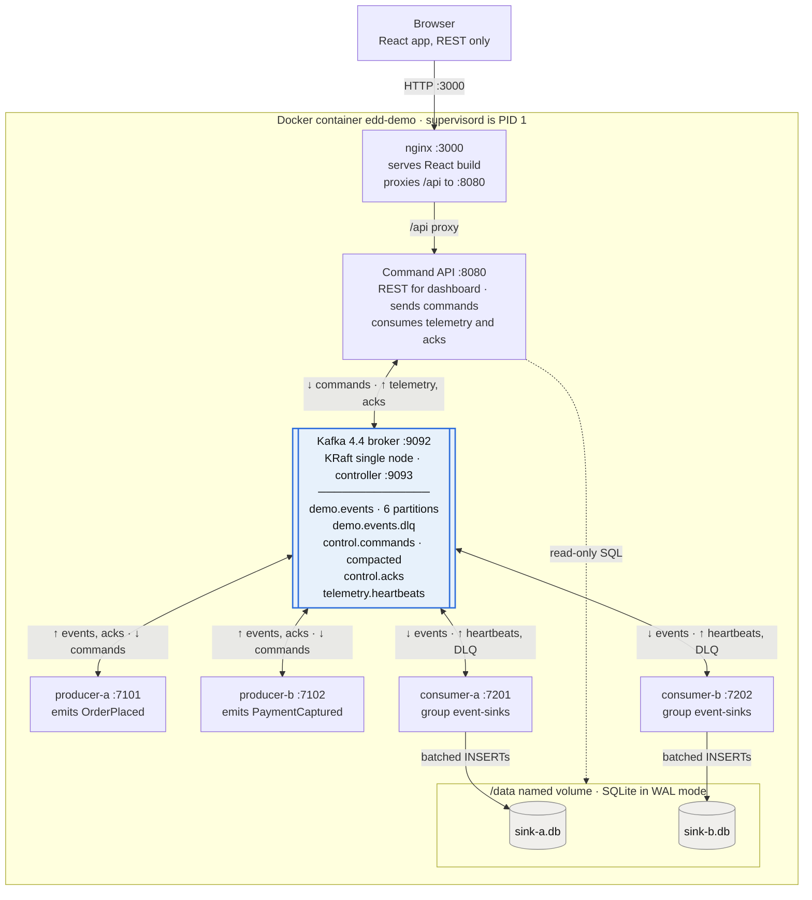
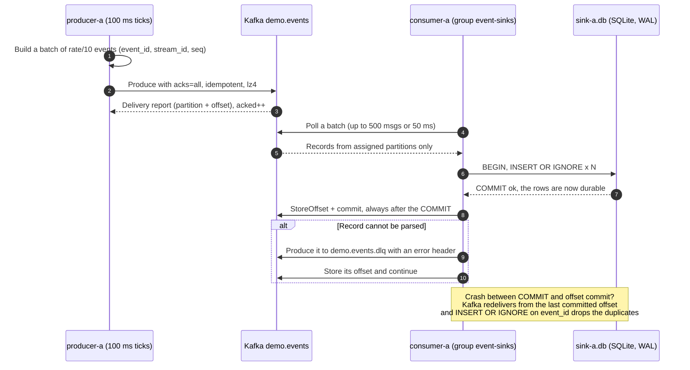
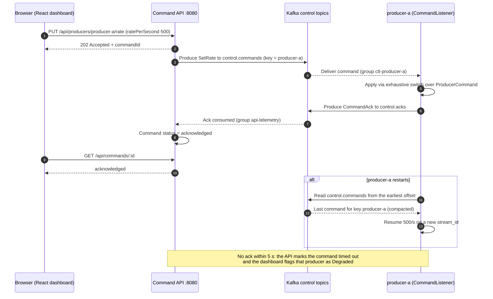
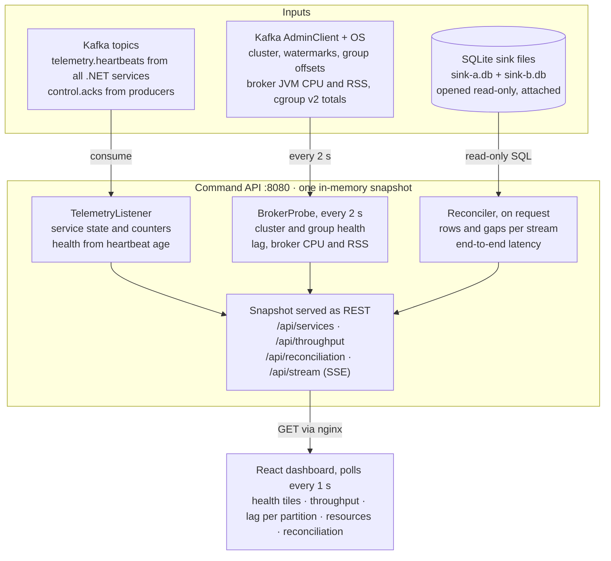
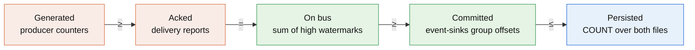
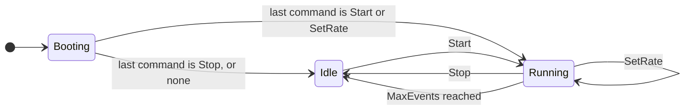
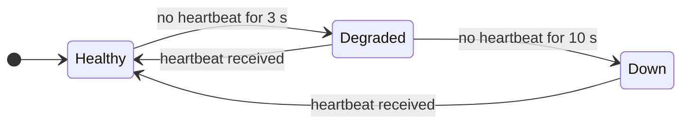
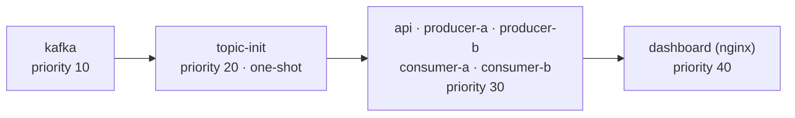

# Event-Driven Architecture Demo: Game Plan (.NET 11 / C# 15)

> Prepared for Tayyab · As of 11 November 2026
>
> Interview demo: two producers, two consumers, one command API and one React dashboard. Kafka is the only channel between services, SQLite files are the sinks, and everything runs in a single Docker container.

Diagrams are written in Mermaid. They render on GitHub and GitLab, and in VS Code with a Mermaid preview extension.

---

## Contents

0. [Executive summary](#0-executive-summary)
1. [Requirements breakdown](#1-requirements-breakdown)
2. [Research findings](#2-research-findings)
3. [Decision record](#3-decision-record)
4. [Diagram 1: System architecture](#4-diagram-1-system-architecture)
5. [Topics and message contracts](#5-topics-and-message-contracts)
6. [Diagram 2: Data-plane event flow](#6-diagram-2-data-plane-event-flow)
7. [Diagram 3: Control-plane command flow](#7-diagram-3-control-plane-command-flow)
8. [Diagram 4: Telemetry, health and reconciliation](#8-diagram-4-telemetry-health-and-reconciliation)
9. [Single-container packaging](#9-single-container-packaging)
10. [Solution layout and implementation notes](#10-solution-layout-and-implementation-notes)
11. [Pure C# vs MediatR](#11-pure-c-vs-mediatr)
12. [Build plan](#12-build-plan)
13. [Interview demo script and talking points](#13-interview-demo-script-and-talking-points)
14. [Risks, gotchas and fallbacks](#14-risks-gotchas-and-fallbacks)
15. [Sources](#15-sources)

---

## 0. Executive summary

Build the demo on Apache Kafka 4.4 in single-node KRaft mode, with SQLite (WAL) sinks and `supervisord` running every process in one image. Kafka's offsets turn "did every event arrive?" into arithmetic, and the API proves delivery by matching five counts taken from three independent sources. In-process dispatch is plain C# 15, with no MediatR.

| Area | Decision |
| --- | --- |
| Event medium | Apache Kafka 4.4.0, single-node KRaft (combined broker + controller) |
| .NET Kafka client | `Confluent.Kafka` 2.15.x |
| Runtime and language | .NET 11 (GA 10 Nov 2026, STS) and C# 15 |
| In-process dispatch | Pure C#: union types + exhaustive `switch`, plain service classes; no MediatR |
| Sink | SQLite in WAL mode, one file per consumer; the API reads both read-only |
| Packaging | One image, `supervisord` as PID 1, 8 programs, each service on its own port |
| Dashboard | React + Vite + TypeScript behind nginx on :3000; REST polling at 1 s, optional SSE |
| Proof of delivery | Generated ≥ Acked = On bus ≥ Committed ≤ Persisted, with zero sequence gaps after a drain |
| Hard rule | No service calls another service; everything goes through Kafka |

---

## 1. Requirements breakdown

The brief is six services (five .NET, one React), one broker and two embedded DB files, bound by one hard rule: no service ever calls another service. The API's real job is proof: showing that every produced event reached the bus and landed in a DB file.

| Component | Count | Job | Allowed to talk to |
| --- | --- | --- | --- |
| Command API (ASP.NET Core) | 1 | REST for the dashboard, publishes commands, consumes telemetry, reads DB files, reconciles counts | Broker, DB files (read-only), browser (REST in) |
| Producer service | 2 | Generate dummy events at a commanded rate; start, stop, change rate on command | Broker only |
| Consumer (sink) service | 2 | Read events at scale, batch-write them to an embedded DB | Broker, its own DB file |
| Event broker | 1 | Receive, hold and deliver events, commands and telemetry | Everyone above |
| React dashboard | 1 | Health, throughput, resource usage, reconciliation, controls | API only, over REST |
| Embedded DB files | 2 | Event store, one per consumer | Written by its consumer, read by the API |

### Hard constraints

- No direct service-to-service traffic. Commands, acknowledgements, heartbeats, metrics and events all ride the broker. The only exceptions: React → API over REST, and .NET services → DB files on disk.
- The API knows the processed count in real time and can start, stop and set the rate (events/sec) of each producer.
- The API proves delivery twice: events reached the bus, and consumers persisted them.
- The dashboard shows health and resource usage for producers, consumers and the broker itself.
- Stack: C# 15 on .NET 11. Packaging: one Docker container, each service on its own port.

### Ambiguities, resolved

- **Two consumers: split the stream or each read all of it?** Default: one consumer group, so partitions are split between them (competing consumers). That is the "at scale" story and lets you show a live rebalance. Fan-out (separate groups) is a one-line config flip for a second demo moment.
- **One DB file or two?** One file per consumer. Embedded engines allow one writer per file, so two writers on one file means lock contention for no gain.
- **How does the API control a producer it may not call?** A command topic plus an acknowledgement on a status topic: request/reply over the bus.
- **"Real time" over REST?** REST polling at 1 s satisfies the brief; a Server-Sent Events endpoint (still plain HTTP from the API) is the upgrade.
- **Who reports the broker's own CPU and memory?** The broker cannot publish about itself, so a probe inside the API reads the broker process's stats (same container) and its admin API.
- **Brief says "containers", follow-up says one container.** This plan builds one container. The same images split cleanly into Docker Compose if an interviewer asks why not.

---

## 2. Research findings

The stack you asked for is real and current: .NET 11 shipped on 10 Nov 2026 with C# 15 as its default language. The two decisions that actually shape the design are the broker (Kafka wins on provable delivery) and the embedded DB (DuckDB is ruled out by its multi-process rules).

### Platform: .NET 11 and C# 15

- .NET 11 GA'd on 10 Nov 2026 as a Standard Term Support release with two years of support ([announcement](https://devblogs.microsoft.com/dotnet/announcing-dotnet-11/)).
- C# 15 is the default for `net11.0`; only the memory-safety work needs `LangVersion preview` ([What's new in C# 15](https://learn.microsoft.com/en-us/dotnet/csharp/whats-new/csharp-15)).
- Runtime Async is on for `net11.0` without a preview flag: cleaner async stack traces and lower overhead, free for every BackgroundService here ([What's new in .NET 11](https://learn.microsoft.com/en-us/dotnet/core/whats-new/dotnet-11/overview)).
- System.Text.Json in .NET 11 adds C# union support and JSON Lines output, so union-typed messages serialise without custom converters (same page).
- `TypedResults.ServerSentEvents` (since .NET 10) streams an `IAsyncEnumerable` as SSE with no extra package ([example](https://se-dotnet-ecosystem.pages.dev/articles/aspnet/server-sent-events-in-aspnetcore-and-dotnet-10/)).

| C# 15 / .NET 11 feature | Where it earns its place in the demo |
| --- | --- |
| `union` types | `ProducerCommand(Start, Stop, SetRate)`: the producer's command handler is a compiler-checked exhaustive `switch` |
| `closed` hierarchies | `ServiceHealth` → `Healthy`, `Degraded`, `Down`: the API's health evaluator needs no default arm |
| Collection expression arguments | `List<EventRow> batch = [with(capacity: 500)];` for consumer batch buffers |
| Extension indexers | `snapshot["producer-a"]` over the API's telemetry snapshot |
| Labeled `break` / `continue` | `break consume;` out of the nested consume-and-batch loop on shutdown |
| Runtime Async (default) | Readable stack traces in every hosted service, no code change |
| STJ union support | Commands and acks go on the wire as plain JSON |

### Broker options

| Option | Model | Running it in one container | Proving "it reached the bus" | Verdict |
| --- | --- | --- | --- | --- |
| **Apache Kafka 4.4 (KRaft)** | Partitioned, replayable log; consumer groups | One JVM process, Java 17+; no ZooKeeper in 4.x | Exact: partition high-watermarks vs. committed group offsets | **Pick** |
| Redpanda | Kafka API, single native binary | Lighter than the JVM; same .NET client | Same as Kafka | Drop-in fallback if RAM is tight |
| RabbitMQ 4.x | Exchanges, quorum queues, streams | Erlang VM | Acked queue messages are gone; needs publisher confirms plus management counters | Better for RPC and routing than for an audit trail |
| NATS + JetStream | Subjects; JetStream adds persistence | Single Go binary; `/varz` reports its own CPU and RSS | Stream and consumer info give counts | Lightest; strong runner-up |

Kafka facts: 4.4.0 was announced 22 Oct 2026 ([release post](https://www.confluent.io/blog/introducing-apache-kafka-4-4-0/)); 4.x runs only in KRaft mode and needs Java 17+, with a `--standalone` storage format for single-node setups ([quickstart notes](https://glukhov.org/es/data-infrastructure/stream-processing/apache-kafka/)). Kafka 4.2 made share groups ("Queues for Kafka") production-ready ([4.2 release](https://www.confluent.io/es-mx/blog/apache-kafka-4-2-release/)): a good talking point, not used in the build. The .NET client is `Confluent.Kafka` 2.15.x, which targets `net10.0` and runs on .NET 11 ([package](https://nubrowse.com/packages/confluent.kafka)). NATS monitoring reference: [varz](https://docs.nats.io/reference/system/monitor/varz). RabbitMQ 4.2 notes: [Amazon MQ guide](https://docs.aws.amazon.com/amazon-mq/latest/developer-guide/rabbitmq-42.html).

### Embedded storage: SQLite vs DuckDB

- **DuckDB** allows either one process that reads and writes, or many processes that only read ([concurrency docs](https://duckdb.org/docs/stable/connect/concurrency.html)). A consumer holding the file for writing locks the API out. Multi-process writes need its Quack protocol, still beta and client-server ([current docs](https://duckdb.org/docs/current/connect/concurrency.html)), which breaks "engine-less".
- **SQLite in WAL mode**: readers don't block the writer and the writer doesn't block readers, but there is one writer per file. The WAL index lives in shared memory, so every process must be on the same machine ([SQLite WAL](https://www.sqlite.org/docsrc/artifact/9b1dbf50c3fb0831)). One container satisfies that by construction.
- **Verdict:** SQLite, WAL mode, one file per consumer, the API opens both read-only.

### One container, many processes

Docker's guidance is one concern per container, but it documents running several processes under a wrapper script or `supervisord`, with each program's output routed to the container log ([Docker docs](https://docs.docker.com/engine/containers/multi-service_container/)). This plan uses `supervisord`; section 9 has the config.

---

## 3. Decision record

Use Apache Kafka 4.4 in single-node KRaft mode as the only channel between services, SQLite (WAL) as the sink, and `supervisord` to run everything in one image. Kafka is the right call because its offsets turn "did every event arrive?" into arithmetic, and you already run Kafka in production on Fluxora, so follow-up questions on partitions, lag and rebalances are home turf.

| Concern | Choice | Why |
| --- | --- | --- |
| Event medium | Apache Kafka 4.4.0, KRaft, combined broker + controller, one node | Replayable log, consumer groups, exact offsets for the delivery proof |
| Kafka client | `Confluent.Kafka` 2.15.x | Producer, Consumer and AdminClient (watermarks, group offsets, cluster info) in one package |
| Runtime | .NET 11, C# 15 | Asked for; unions and closed hierarchies model commands and health cleanly |
| In-process dispatch | Pure C#: union + exhaustive `switch`, plain service classes | Compile-time exhaustiveness; nothing to license or defend (section 11) |
| Command API | ASP.NET Core minimal API on :8080 | REST for the dashboard; hosted services for telemetry and probes |
| Producers, consumers | Worker services plus a tiny Kestrel endpoint (`/healthz`, `/metrics`) each | Gives every service its own port without any service calling another |
| Storage | SQLite WAL via `Microsoft.Data.Sqlite`, one file per consumer | Concurrent read while writing; no server process |
| Wire format | JSON (System.Text.Json source-gen) with CloudEvents-style headers | Readable in Kafka tooling; no schema-registry process to run |
| Dashboard | React + Vite + TypeScript, TanStack Query (1 s polling), Recharts; nginx on :3000 serves the build and proxies `/api` | No CORS, one URL to open |
| Real-time to the UI | REST polling at 1 s; SSE endpoint as an upgrade | Meets "REST only" literally; SSE is still plain HTTP |
| Process manager | `supervisord` | Start order, restarts, unified logs, and `supervisorctl stop` for failure drills |
| Delivery semantics | Idempotent producer (`acks=all`); consumer commits offsets after the DB commit; `INSERT OR IGNORE` on `event_id` | At-least-once delivery plus an idempotent sink = effectively-once rows |

### Rejected, with the one-line reason you'll give if asked

- **RabbitMQ:** excellent for commands and routing, but consumed messages vanish, so the "reached the bus" proof gets weaker.
- **NATS JetStream:** the lightest option and a fine design; Kafka wins on offset-based audit and on how often interviewers expect it.
- **DuckDB:** one writing process locks out every reader process.
- **SignalR / WebSockets:** the brief says REST; SSE covers live push if wanted.
- **MediatR:** in-process only, so it touches none of the event-driven parts; C# 15 unions give compile-time dispatch; 13.0+ is dual RPL-1.5 / commercial licensed. Full analysis in section 11.
- **MassTransit or similar:** an abstraction you'd have to defend, and its newer versions moved to commercial licensing ([note](https://se-dotnet-ecosystem.pages.dev/articles/aspnet/server-sent-events-in-aspnetcore-and-dotnet-10/)).
- **Docker Compose:** the idiomatic choice, and the fallback if an interviewer pushes on "one process per container". The same images split cleanly.

---

## 4. Diagram 1: System architecture

Everything runs in one container, and Kafka is the only thing any service talks to.



Every solid service arrow ends at the broker. The only other paths are the browser reaching the API through nginx, and the API reading both SQLite files read-only (dashed). All .NET services publish heartbeats; consumers route poison records to `demo.events.dlq`.

### Port map

| Port | Process | Publish to host | Who may call it |
| --- | --- | --- | --- |
| 3000 | nginx: React build + `/api` proxy to 8080 | Yes | Browser |
| 8080 | Command API | Yes | Browser (through 3000), curl |
| 9092 | Kafka broker (PLAINTEXT) | Yes | All .NET services; kcat or Kafka UI from your laptop |
| 9093 | Kafka controller (KRaft) | No | Kafka only |
| 7101, 7102 | producer-a, producer-b: `/healthz`, `/metrics` | Optional | Docker HEALTHCHECK and you; **never** another service |
| 7201, 7202 | consumer-a, consumer-b: same | Optional | Same |

The worker ports exist so every service has its own port and can be probed by humans. Nothing in the system calls them, which keeps the no-direct-connection rule intact.

---

## 5. Topics and message contracts

Five topics carry everything: one data topic, one dead-letter topic, and three control-and-telemetry topics. Every event carries a `stream_id` and a gap-free `seq`, which is what lets the API prove nothing was lost.

| Topic | Partitions | Key | Cleanup | Written by | Read by |
| --- | --- | --- | --- | --- | --- |
| `demo.events` | 6 | Entity id (e.g. order id) | delete, 24 h | producer-a, producer-b | group `event-sinks`: consumer-a, consumer-b |
| `demo.events.dlq` | 1 | Original key | delete, 7 days | Consumers, for poison messages | API (count on dashboard) |
| `control.commands` | 1 | Target service id | **compact** | API | Each producer, own group, filters on its own key |
| `control.acks` | 1 | Command id | delete, 1 h | Producers | API |
| `telemetry.heartbeats` | 1 | Service id | delete, 1 h | All five .NET services | API |

Why these choices:

- **6 partitions** let you scale the sink group from 2 to 6 instances live, and make the rebalance visible (3 + 3 → 6 + 0 when one consumer stops).
- **Compacted `control.commands`** keeps the last command per producer. A restarted producer replays its key from the start and resumes the desired state on its own: the "desired-state reconciliation" pattern.
- **"All producers"** is fanned out by the API into one command per producer, so compaction never has to merge targets.
- **Single-partition control topics** keep commands in issue order; their volume is tiny.

### Event envelope

Headers follow CloudEvents naming so any Kafka tool shows them: `ce_specversion=1.0`, `ce_id` (UUIDv7 via `Guid.CreateVersion7()`), `ce_type` (`OrderPlaced` or `PaymentCaptured`), `ce_source` (`producer-a`), `ce_time`, plus `x-run-id`, `x-stream-id` and `x-seq`. The value is a small JSON body of dummy fields.

- `run_id` = the command id of the `Start` that began the run.
- `stream_id` = a fresh UUIDv7 each time a producer begins emitting, including after a crash; `seq` restarts at 1. Gap checks run per `stream_id`, so restarts never look like losses.

### C# 15 contracts (shared project)

```csharp
// Commands: a union, so every handler is an exhaustive switch
public sealed record Start(string CommandId, int RatePerSecond, long? MaxEvents);
public sealed record Stop(string CommandId);
public sealed record SetRate(string CommandId, int RatePerSecond);
public union ProducerCommand(Start, Stop, SetRate);

// Health: a closed hierarchy, so the evaluator needs no default arm
public closed record class ServiceHealth;
public record class Healthy : ServiceHealth;
public record class Degraded(string Reason) : ServiceHealth;
public record class Down(DateTimeOffset LastSeen) : ServiceHealth;

public sealed record CommandAck(string CommandId, string ServiceId, bool Accepted, string State, DateTimeOffset At);

public sealed record Heartbeat(
    string ServiceId, string Kind, string State, DateTimeOffset At,
    double CpuPercent, long WorkingSetBytes, long GcHeapBytes, int Threads,
    string? StreamId,                                  // producers: current stream
    long Generated, long Acked, long Failed,           // producers
    long Consumed, long Persisted, long DeadLettered,  // consumers
    int[] Assigned);                                   // consumers: assigned partitions

// Producer command handler
state = command switch
{
    Start s   => StartRun(s),
    Stop s    => StopRun(s),
    SetRate r => ChangeRate(r),
};
```

Pin the JSON shape of the union in a unit test on day one. If .NET 11's built-in union serialisation doesn't give the shape you want on the wire, fall back to a `[JsonPolymorphic]` `type` discriminator.

### SQLite schema (one file per consumer)

```sql
PRAGMA journal_mode = WAL;
PRAGMA synchronous  = NORMAL;
PRAGMA busy_timeout = 5000;

CREATE TABLE IF NOT EXISTS events (
  event_id        TEXT    PRIMARY KEY,   -- ce_id, UUIDv7
  producer_id     TEXT    NOT NULL,
  run_id          TEXT    NOT NULL,
  stream_id       TEXT    NOT NULL,
  seq             INTEGER NOT NULL,
  event_type      TEXT    NOT NULL,
  payload         TEXT    NOT NULL,
  kafka_partition INTEGER NOT NULL,
  kafka_offset    INTEGER NOT NULL,
  produced_at_ms  INTEGER NOT NULL,
  consumed_at_ms  INTEGER NOT NULL,
  persisted_at_ms INTEGER NOT NULL,
  sink_id         TEXT    NOT NULL
);
CREATE UNIQUE INDEX IF NOT EXISTS ux_stream_seq ON events(stream_id, seq);
CREATE INDEX IF NOT EXISTS ix_persisted ON events(persisted_at_ms);
```

The API opens `sink-a.db` read-only and attaches `sink-b.db` read-only, because one stream's events are split across both files by partition:

```sql
ATTACH DATABASE 'file:/data/sink-b.db?mode=ro' AS b;

-- missing = 0 for every stream once lag is 0
SELECT producer_id, stream_id,
       COUNT(*)            AS rows_persisted,
       MAX(seq)            AS max_seq,
       MAX(seq) - COUNT(*) AS missing
FROM (SELECT producer_id, stream_id, seq FROM main.events
      UNION ALL
      SELECT producer_id, stream_id, seq FROM b.events)
GROUP BY producer_id, stream_id;
```

While events are in flight, `missing` is briefly positive. The check is conclusive after a `Stop` once consumer lag reaches 0.

---

## 6. Diagram 2: Data-plane event flow

Each event crosses the bus once and lands in SQLite as part of a batch. The order of the COMMIT and the offset commit is what makes the pipeline lossless: rows commit before offsets, so a crash causes duplicates, never loss.



Producers fire and forget but count every delivery report. Consumers write first and commit offsets second, so the worst case after a crash is a redelivered batch that the primary key quietly absorbs.

---

## 7. Diagram 3: Control-plane command flow

Control is request/reply over the bus: the API publishes a command, the producer acknowledges on a second topic, and the browser sees the result by polling. The API never calls a producer.



The 202 comes back before anything is applied, so the UI shows a pending command until the ack flips it to acknowledged. Because `control.commands` is compacted, a restarted producer recovers its last instruction without anyone calling it.

---

## 8. Diagram 4: Telemetry, health and reconciliation

The API builds one in-memory snapshot from three kinds of input (Kafka topics, Kafka admin data plus OS stats, and the SQLite files) and serves it to the dashboard over REST.



Health comes from heartbeat age, resource usage from each process's own report (or the OS, for the broker), and the delivery proof from counts no single component can fake: producers report what they sent, Kafka reports what it holds and what the group committed, and SQLite reports what landed.

### The proof: five counts from three independent sources

`/api/reconciliation` returns this chain:



| Count | Source | Colour above |
| --- | --- | --- |
| Generated, Acked | Producer heartbeats (counters per `stream_id`) | Orange |
| On bus, Committed | Kafka offsets via AdminClient | Green |
| Persisted | SQLite rows across both files | Blue |

- **After Stop and drain:** Acked = On bus = Committed = Persisted, and `missing = 0` for every stream.
- **While running:** lag = On bus − Committed, and Persisted may run up to one batch ahead of Committed (never behind, because offsets commit after rows).

### Where health and resource numbers come from

| Component | Health signal | Resource numbers |
| --- | --- | --- |
| Producers, consumers | Heartbeat age on `telemetry.heartbeats` | Self-reported in the heartbeat: CPU %, working set, GC heap, threads |
| Command API | Itself (`/healthz` for Docker) | Its own `Process` stats |
| Kafka broker | AdminClient `DescribeCluster` succeeds; group state from `DescribeConsumerGroups` | `Process.GetProcessesByName("java")`: CPU time and RSS |
| Whole container | — | cgroup v2: `/sys/fs/cgroup/memory.current`, `cpu.stat` |

CPU % for any process = Δ `TotalProcessorTime` ÷ (Δ wall time × `Environment.ProcessorCount`) × 100.

### State machines

Producer lifecycle, as driven by commands and by replay of the compacted command key:



Two rules keep replay honest, and both keep the API as the only writer of `control.commands`:

- The API accepts `SetRate` only for a producer it currently sees as Running (otherwise `409 Conflict`), so the compacted key never ends in a `SetRate` for an idle producer.
- When `MaxEvents` is reached, the producer reports `RunCompleted` on `control.acks`; the API then writes a `Stop` for that key, so a restart won't replay a finished run.

Health, as evaluated by the API from heartbeat age:



---

## 9. Single-container packaging

One multi-stage Dockerfile builds the .NET services and the React app, copies in Kafka and a JRE, and hands PID 1 to `supervisord`, which starts eight programs in priority order. One `docker run` brings the whole demo up.



Priorities set start order, not readiness, so every .NET service must tolerate a broker that isn't up yet: wait on AdminClient metadata until its topics exist, then subscribe.

### Dockerfile

```dockerfile
# 1) .NET build
FROM mcr.microsoft.com/dotnet/sdk:11.0 AS dotnet
WORKDIR /src
COPY . .
RUN dotnet publish src/Edd.Api      -c Release -o /out/api \
 && dotnet publish src/Edd.Producer -c Release -o /out/producer \
 && dotnet publish src/Edd.Consumer -c Release -o /out/consumer

# 2) React build
FROM node:24-alpine AS web
WORKDIR /web
COPY web/package*.json ./
RUN npm ci
COPY web/ .
RUN npm run build

# 3) Kafka binaries and a JRE, taken from official images
FROM apache/kafka:4.4.0 AS kafka
FROM eclipse-temurin:21-jre AS jre

# 4) Runtime: default (apt-based) ASP.NET image, not chiseled
FROM mcr.microsoft.com/dotnet/aspnet:11.0
RUN apt-get update \
 && apt-get install -y --no-install-recommends supervisor nginx curl \
 && rm -f /etc/nginx/sites-enabled/default \
 && rm -rf /var/lib/apt/lists/*
COPY --from=jre   /opt/java/openjdk /opt/java/openjdk
COPY --from=kafka /opt/kafka        /opt/kafka
ENV JAVA_HOME=/opt/java/openjdk PATH="$PATH:/opt/java/openjdk/bin"
COPY --from=dotnet /out           /app
COPY --from=web    /web/dist      /usr/share/nginx/html
COPY deploy/supervisord.conf      /etc/supervisor/conf.d/edd.conf
COPY deploy/nginx.conf            /etc/nginx/conf.d/default.conf
COPY deploy/kafka.properties      /opt/kafka/config/edd.properties
COPY deploy/scripts/              /scripts/
RUN chmod +x /scripts/*.sh
EXPOSE 3000 8080 9092
VOLUME /data
HEALTHCHECK --interval=10s CMD curl -fs http://localhost:8080/healthz || exit 1
ENTRYPOINT ["/usr/bin/supervisord", "-n", "-c", "/etc/supervisor/supervisord.conf"]
```

Check once that `apache/kafka:4.4.0` still keeps Kafka under `/opt/kafka`; if it moved, copy from the new path or download the 4.4.0 tarball instead.

### Kafka (single node, combined mode)

```properties
process.roles=broker,controller
node.id=1
controller.quorum.bootstrap.servers=localhost:9093
listeners=PLAINTEXT://:9092,CONTROLLER://:9093
advertised.listeners=PLAINTEXT://localhost:9092
controller.listener.names=CONTROLLER
listener.security.protocol.map=PLAINTEXT:PLAINTEXT,CONTROLLER:PLAINTEXT
log.dirs=/data/kafka
auto.create.topics.enable=false
offsets.topic.replication.factor=1
transaction.state.log.replication.factor=1
transaction.state.log.min.isr=1
group.initial.rebalance.delay.ms=0
```

`advertised.listeners=localhost:9092` works for processes inside the container and for tools on your laptop, because port 9092 is published to the same name.

```bash
#!/usr/bin/env bash
# /scripts/start-kafka.sh: format storage on first boot only, then run in the foreground
set -euo pipefail
CFG=/opt/kafka/config/edd.properties
if [ ! -f /data/kafka/meta.properties ]; then
  /opt/kafka/bin/kafka-storage.sh format --standalone \
    -t "$(/opt/kafka/bin/kafka-storage.sh random-uuid)" -c "$CFG"
fi
exec /opt/kafka/bin/kafka-server-start.sh "$CFG"
```

```bash
#!/usr/bin/env bash
# /scripts/init-topics.sh: wait for the broker, create topics idempotently, exit 0
set -euo pipefail
T=/opt/kafka/bin/kafka-topics.sh; B=localhost:9092
until $T --bootstrap-server $B --list >/dev/null 2>&1; do sleep 1; done
$T --bootstrap-server $B --create --if-not-exists --topic demo.events          --partitions 6 --replication-factor 1 --config retention.ms=86400000
$T --bootstrap-server $B --create --if-not-exists --topic demo.events.dlq      --partitions 1 --replication-factor 1 --config retention.ms=604800000
$T --bootstrap-server $B --create --if-not-exists --topic control.commands     --partitions 1 --replication-factor 1 --config cleanup.policy=compact
$T --bootstrap-server $B --create --if-not-exists --topic control.acks         --partitions 1 --replication-factor 1 --config retention.ms=3600000
$T --bootstrap-server $B --create --if-not-exists --topic telemetry.heartbeats --partitions 1 --replication-factor 1 --config retention.ms=3600000
```

### supervisord

```ini
[supervisord]
nodaemon=true
logfile=/dev/null
logfile_maxbytes=0

[program:kafka]
command=/scripts/start-kafka.sh
priority=10
environment=KAFKA_HEAP_OPTS="-Xms512m -Xmx512m"
stdout_logfile=/dev/fd/1
stdout_logfile_maxbytes=0
redirect_stderr=true

[program:topic-init]
command=/scripts/init-topics.sh
priority=20
autorestart=false
startsecs=0

[program:api]
command=dotnet /app/api/Edd.Api.dll
priority=30
environment=ASPNETCORE_URLS="http://0.0.0.0:8080",Kafka__Bootstrap="localhost:9092",Sinks__Paths="/data/sink-a.db;/data/sink-b.db"

[program:producer-a]
command=dotnet /app/producer/Edd.Producer.dll
priority=30
environment=ASPNETCORE_URLS="http://0.0.0.0:7101",Service__Id="producer-a",Service__EventType="OrderPlaced"

[program:producer-b]
command=dotnet /app/producer/Edd.Producer.dll
priority=30
environment=ASPNETCORE_URLS="http://0.0.0.0:7102",Service__Id="producer-b",Service__EventType="PaymentCaptured"

[program:consumer-a]
command=dotnet /app/consumer/Edd.Consumer.dll
priority=30
environment=ASPNETCORE_URLS="http://0.0.0.0:7201",Service__Id="consumer-a",Sink__Path="/data/sink-a.db"

[program:consumer-b]
command=dotnet /app/consumer/Edd.Consumer.dll
priority=30
environment=ASPNETCORE_URLS="http://0.0.0.0:7202",Service__Id="consumer-b",Sink__Path="/data/sink-b.db"

[program:dashboard]
command=nginx -g "daemon off;"
priority=40
```

Give every program the same three log lines as `kafka` (`stdout_logfile=/dev/fd/1`, `stdout_logfile_maxbytes=0`, `redirect_stderr=true`) so all output lands in `docker logs`.

### Build and run

```bash
docker build -t edd-demo .
docker run -d --name edd -p 3000:3000 -p 8080:8080 -p 9092:9092 -v edd-data:/data edd-demo

# failure drills during the demo
docker exec edd supervisorctl stop consumer-b     # watch partitions move to consumer-a
docker exec edd supervisorctl start consumer-b    # watch them rebalance back
```

Use a named volume (`edd-data`), not a bind mount from a Windows or macOS host folder: SQLite WAL relies on shared memory, which those mounts handle poorly.

---

## 10. Solution layout and implementation notes

Three deployable .NET projects share two libraries, so the contracts and the Kafka plumbing are written once. Each service section below lists only what is specific to it.

```text
edd-demo/
├─ Directory.Build.props        # net11.0, Nullable, TreatWarningsAsErrors
├─ edd-demo.slnx
├─ src/
│  ├─ Edd.Contracts/            # unions, closed records, topic names, JSON source-gen context
│  ├─ Edd.Messaging/            # Kafka config factories, heartbeat publisher, resource sampler, IMessageHandler<T>
│  ├─ Edd.Api/                  # minimal API + hosted services
│  ├─ Edd.Producer/             # worker + Kestrel /healthz, /metrics
│  └─ Edd.Consumer/             # worker + Kestrel /healthz, /metrics
├─ tests/Edd.Tests/             # union JSON shape, gap query, rate maths
├─ web/                         # React + Vite + TypeScript
└─ deploy/                      # supervisord.conf, nginx.conf, kafka.properties, scripts/
```

### Producer (×2)

- **CommandListener:** consumes `control.commands` in group `ctl-<serviceId>` from the earliest offset and keeps only its own key, so a restart replays the compacted desired state. After applying a command it publishes a `CommandAck` to `control.acks`.
- **Generator:** a `PeriodicTimer` at 100 ms emits `rate / 10` events per tick, carrying the remainder; it stops at `MaxEvents` if set and reports `RunCompleted`. Each start or resume opens a new `stream_id`.
- **Kafka settings:** `Acks = All`, `EnableIdempotence = true`, `LingerMs = 5`, `CompressionType = Lz4`. Call `Produce(...)` with a delivery handler rather than awaiting `ProduceAsync` per message, so librdkafka can batch.
- **Counters:** `Interlocked` totals for generated, acked (delivery report OK) and failed, published every second in the heartbeat together with the current `stream_id`.

### Consumer (×2)

- **Kafka settings:** `GroupId = event-sinks`, `EnableAutoCommit = true`, `EnableAutoOffsetStore = false`, `AutoOffsetReset = Earliest`, `PartitionAssignmentStrategy = CooperativeSticky`.
- **Loop:** take up to 500 messages or 50 ms, write them in one SQLite transaction with a reused prepared `INSERT OR IGNORE`, commit, then `StoreOffset` for the last message per partition. DB first, offsets second = at-least-once; the primary key absorbs redeliveries.
- **Startup:** create the DB file, apply the PRAGMAs (WAL) and the schema before subscribing, so the API never finds a half-initialised file.
- **Poison messages:** unparseable records go to `demo.events.dlq` with an error header; the offset is stored and the loop continues.
- **Rebalance visibility:** partition assigned/revoked handlers log, and the consumer puts its `Assigned` partition list in its heartbeat so the dashboard shows partitions moving.
- **Counters:** consumed, persisted, dead-lettered, last batch size and duration.

### Command API (×1)

- **TelemetryListener:** consumes `telemetry.heartbeats` and `control.acks` (group `api-telemetry`, latest offset) into an in-memory snapshot. Sums producer counters per `stream_id`, so restarts don't reset totals.
- **HealthEvaluator:** maps heartbeat age to the closed `ServiceHealth` hierarchy: under 3 s `Healthy`, under 10 s `Degraded`, otherwise `Down`.
- **BrokerProbe (every 2 s):** AdminClient `DescribeCluster`, latest offsets for `demo.events`, committed offsets and member assignment for `event-sinks`; broker JVM CPU and RSS via `Process.GetProcessesByName("java")`; container totals from cgroup v2 (`/sys/fs/cgroup/memory.current`, `cpu.stat`). It talks only to the broker and the OS, never to a service.
- **CommandPublisher:** produces to `control.commands` keyed by target; fans "all producers" out into one command each; writes a `Stop` after a `RunCompleted`; times out commands with no ack after 5 s.

| Method | Path | Does |
| --- | --- | --- |
| GET | `/api/services` | Health and resources for producers, consumers, broker, API |
| GET | `/api/throughput` | Events/s generated, acked and persisted, from counter deltas |
| GET | `/api/reconciliation` | The five-stage count chain, lag per partition, gap check per stream |
| GET | `/api/events/recent?limit=50` | Newest rows across both DB files |
| POST | `/api/producers/{id}/start` | Body `{ratePerSecond, maxEvents?}` → 202 + `commandId` |
| POST | `/api/producers/{id}/stop` | 202 + `commandId` |
| PUT | `/api/producers/{id}/rate` | Body `{ratePerSecond}` → 202 + `commandId` (409 if the producer isn't Running) |
| GET | `/api/commands/{commandId}` | Pending, acknowledged or timed out |
| GET | `/api/stream` | Optional SSE: the same snapshot pushed every second |
| GET | `/healthz` | Liveness for Docker |

### Dashboard

- Panels: health tiles for all six components, a throughput line chart (generated/s vs persisted/s), the reconciliation chain, lag per partition, a resource table (CPU %, RSS MB), producer controls (start, stop, rate slider) and a recent-events table.
- TanStack Query with `refetchInterval: 1000`; every call uses a relative `/api/...` path so nginx proxies it.

```nginx
server {
  listen 3000;
  root /usr/share/nginx/html;
  location /api/ { proxy_pass http://127.0.0.1:8080; proxy_buffering off; }
  location /     { try_files $uri /index.html; }
}
```

`proxy_buffering off` keeps the optional SSE stream live. The Dockerfile deletes nginx's packaged default site so only this server block loads.

---

## 11. Pure C# vs MediatR

Go pure C#. MediatR adds nothing to this design, and it can muddy the interview story.

### Why skip it

- **It works at the wrong layer.** MediatR routes a request to a handler inside a single process. Every message that matters in this demo crosses a process boundary through Kafka. "MediatR is in-process; my events go through the broker" is a strong line in an interview, but it only works if you don't depend on MediatR yourself.
- **C# 15 already handles dispatch.** The `ProducerCommand` union plus an exhaustive `switch` is your mediator. If you forget a case, the compiler catches it. With MediatR you'd only find out at runtime, from a missing-handler exception.
- **The licence would need explaining.** MediatR 12.5.0 is the last release under plain Apache 2.0. MediatR 13.0 (released 2 July 2025) and the 14.x line ship under a dual Reciprocal Public License 1.5 / commercial model from Lucky Penny Software. A free Community edition covers companies and individuals under USD 5,000,000 gross annual revenue ([analysis](https://startdebugging.net/2026/05/mediatr-vs-plain-service-classes-in-2026/), [background](https://milanjovanovic.tech/blog/mediatr-and-masstransit-going-commercial-what-this-means-for-you)). Not a blocker, just one more thing to justify.
- **Cross-cutting concerns are already covered.** Endpoint filters handle validation and logging on the API. A thin wrapper around the consume loop handles logging, metrics and the DLQ. `Microsoft.Extensions.Resilience` handles retries.

| Concern | With MediatR | Pure C# in this demo |
| --- | --- | --- |
| Command dispatch in producers | `IRequestHandler<T>` per command, resolved at runtime | Union + exhaustive `switch`, checked at compile time |
| API endpoint → logic | `mediator.Send(new SetRateRequest(...))` | Endpoint calls `ICommandPublisher` directly |
| Logging, validation, retries | Pipeline behaviours | Endpoint filters, consume-loop wrapper, `Microsoft.Extensions.Resilience` |
| Cross-process messaging | Not provided | Kafka (the actual event-driven part) |
| Licence | RPL-1.5 or commercial (13.0+), Community tier under USD 5M revenue | None |

### The whole "mediator" you need

```csharp
// Edd.Messaging
public interface IMessageHandler<in T>
{
    ValueTask HandleAsync(T message, CancellationToken ct);
}

// Producer's CommandListener: one call site, checked by the compiler
ValueTask Dispatch(ProducerCommand cmd, CancellationToken ct) => cmd switch
{
    Start s   => start.HandleAsync(s, ct),
    Stop s    => stop.HandleAsync(s, ct),
    SetRate r => rate.HandleAsync(r, ct),
};
```

On the API side, minimal API endpoints call plain service classes directly, so there's no request/handler indirection to explain:

```csharp
app.MapPut("/api/producers/{id}/rate",
    async Task<Results<Accepted<CommandRef>, Conflict>> (
        string id, SetRateRequest body, ICommandPublisher commands, CancellationToken ct) =>
    {
        if (!commands.IsRunning(id)) return TypedResults.Conflict();
        var cmd = await commands.SetRateAsync(id, body.RatePerSecond, ct);
        return TypedResults.Accepted($"/api/commands/{cmd.CommandId}", cmd);
    });
```

MediatR is worth it when an app has dozens of handlers and you rely on its pipeline behaviours. A demo with three commands and a handful of endpoints doesn't come close.

---

## 12. Build plan

Build in six phases, each ending in something you can run and check. The data plane comes before the control plane, so there is a working pipeline to control.

| Phase | Build | Done when |
| --- | --- | --- |
| 0. Skeleton | Solution, `Directory.Build.props`, `Edd.Contracts` with the union and closed types, Dockerfile with Kafka + `topic-init` only | `docker run` starts Kafka; `kafka-topics.sh --list` shows all five topics; the union JSON-shape test passes |
| 1. Data plane | Producer at a fixed rate (config value), consumer batching into SQLite | Rows land in both DB files; after stopping, the gap query returns `missing = 0` for every stream |
| 2. Control plane | `control.commands` listener, acks, generator start/stop/rate; API command endpoints | `curl` start, change rate, stop; each returns a `commandId` that turns "acknowledged" within a second or two |
| 3. Telemetry and proof | Heartbeats, HealthEvaluator, BrokerProbe, `/api/reconciliation` | After a stop and drain: acked = on bus = committed = persisted; stopping a consumer marks it `Down` within 10 s |
| 4. Dashboard | React panels and controls behind nginx | Every number on screen traces to one API endpoint; controls work without a page reload |
| 5. Hardening and rehearsal | Healthchecks, README, DLQ path, the failure drills in section 13 | The full demo script runs end to end twice from a cold `docker run` |

Tests that pay for themselves: the union JSON shape, the gap query against a seeded SQLite file, the rate-per-tick maths (including remainders), the health thresholds, and the replay rules (no restart of an idle or finished producer).

---

## 13. Interview demo script and talking points

Run the demo as a story with two failures and one proof: start traffic, break things, watch the system heal, then show the numbers reconcile. Rates below are examples; pick ones your laptop sustains comfortably and rehearse with them.

1. **Open :3000.** Six green tiles, all counters at zero. Show Diagram 1: every service arrow ends at the broker.
2. **Start both producers** at 200 events/s. The `commandId` flips to "acknowledged"; throughput rises; each consumer owns 3 partitions.
3. **Raise producer-a** to a much higher rate. Lag bars spike, then drain; CPU in the resource table climbs.
4. **Stop consumer-b** (`supervisorctl stop consumer-b`). Its tile goes Degraded, then Down; all 6 partitions move to consumer-a; lag grows, then recovers.
5. **Start consumer-b again.** Cooperative rebalance back to 3 + 3, no stop-the-world pause.
6. **Stop producer-a.** `supervisord` restarts it; it replays its compacted command and resumes on a new `stream_id` with no one touching it.
7. **Stop everything and wait for lag 0.** Open Reconciliation: acked = on bus = committed = persisted, and `missing = 0` for every stream. That is the proof.
8. *Optional:* push a malformed record with kcat. The DLQ counter ticks up and the pipeline keeps flowing.
9. *Optional:* restart consumer-b with its own group id. Each consumer now sees every event (fan-out), so persisted = 2 × produced.

### Talking points to have ready

- **Log vs queue:** Kafka keeps events after they're read, so offsets are an audit trail and replay is free.
- **Delivery semantics:** idempotent producer + commit-after-write consumer + primary-key sink = effectively-once rows, without Kafka transactions.
- **Ordering:** guaranteed per partition only; the key decides what must stay in order.
- **Backpressure:** lag is the signal. A next step is a governor in the API that lowers producer rates when lag crosses a threshold.
- **Desired state over RPC:** a compacted command topic lets a crashed producer recover its intent with nobody calling it.
- **Why one container:** a packaging choice for a demo. On AKS you'd run each service as its own Deployment and scale the sink group on consumer lag (for example with KEDA's Kafka scaler).
- **C# 15:** unions and closed hierarchies make an unknown command or an unhandled health state a compile error, not a runtime surprise.
- **Why no MediatR:** it's an in-process mediator; this system's events cross process boundaries through Kafka, and C# 15 unions already give compile-checked dispatch.
- **What's next:** OpenTelemetry trace context in Kafka headers for end-to-end traces across services.

---

## 14. Risks, gotchas and fallbacks

Most risk sits in startup ordering, SQLite file handling, command replay and brand-new releases; each has a cheap mitigation built into the plan.

| Risk | What you'd see | Mitigation |
| --- | --- | --- |
| Services start before the broker or topics | `UnknownTopicOrPartition` in logs, crash loops | `topic-init` one-shot; every service waits on AdminClient metadata before subscribing; librdkafka reconnects on its own |
| Kafka's JVM squeezes the container | Slow start, OOM kills | Heap capped at 512 MB; give Docker enough memory; swap to Redpanda (same client, same topics) if still tight |
| SQLite WAL on a host bind mount | `SQLITE_BUSY`, odd lock errors | Named volume only; `busy_timeout = 5000`; exactly one writer per file |
| API opens a sink file before it exists | Read errors on first boot | Consumers create the file and set WAL at startup; the API retries until both files exist |
| Counters reset when a producer restarts | Totals on screen drop or double | Heartbeats carry `stream_id`; the API sums per stream; the proof uses offsets and DB rows, not process counters |
| Compacted command replay restarts an idle or finished producer | A producer starts emitting after a reboot nobody asked for | The API is the only writer of `control.commands`; `SetRate` only while Running (409 otherwise); the API writes `Stop` after `RunCompleted` |
| C# 15 union serialisation shape | Wire format differs from what the UI expects | Contract test from phase 0; `[JsonPolymorphic]` fallback |
| Day-one releases (.NET 11 GA'd 10 Nov 2026; Kafka 4.4 is weeks old) | Unexplained tooling or runtime issues | Pin exact versions; fall back to Kafka 4.3.x if 4.4 misbehaves |
| Host tools can't reach Kafka | kcat or Kafka UI time out | `advertised.listeners=localhost:9092` plus `-p 9092:9092` |
| Interviewer challenges "one container" | — | Agree it's a demo packaging choice; show the Compose file kept in the repo as plan B |
| Laptop struggles on the day | Laggy UI, dropped frames on screen share | Conservative default rates; rehearse twice cold; keep a recorded run as backup |

---

## 15. Sources

- [Announcing .NET 11](https://devblogs.microsoft.com/dotnet/announcing-dotnet-11/), .NET blog
- [What's new in C# 15](https://learn.microsoft.com/en-us/dotnet/csharp/whats-new/csharp-15), Microsoft Learn
- [What's new in .NET 11](https://learn.microsoft.com/en-us/dotnet/core/whats-new/dotnet-11/overview), Microsoft Learn
- [Introducing Apache Kafka 4.4.0](https://www.confluent.io/blog/introducing-apache-kafka-4-4-0/), Confluent
- [Apache Kafka 4.2 release](https://www.confluent.io/es-mx/blog/apache-kafka-4-2-release/), Confluent
- [Kafka 4.x quickstart notes](https://glukhov.org/es/data-infrastructure/stream-processing/apache-kafka/)
- [Confluent.Kafka package](https://nubrowse.com/packages/confluent.kafka)
- [DuckDB concurrency](https://duckdb.org/docs/stable/connect/concurrency.html) and [current docs](https://duckdb.org/docs/current/connect/concurrency.html)
- [SQLite write-ahead logging](https://www.sqlite.org/docsrc/artifact/9b1dbf50c3fb0831)
- [Run multiple processes in a container](https://docs.docker.com/engine/containers/multi-service_container/), Docker docs
- [NATS varz monitoring](https://docs.nats.io/reference/system/monitor/varz)
- [RabbitMQ 4.2 on Amazon MQ](https://docs.aws.amazon.com/amazon-mq/latest/developer-guide/rabbitmq-42.html)
- [Server-Sent Events in ASP.NET Core](https://se-dotnet-ecosystem.pages.dev/articles/aspnet/server-sent-events-in-aspnetcore-and-dotnet-10/)
- [MediatR vs plain service classes in 2026](https://startdebugging.net/2026/05/mediatr-vs-plain-service-classes-in-2026/)
- [MediatR and MassTransit going commercial](https://milanjovanovic.tech/blog/mediatr-and-masstransit-going-commercial-what-this-means-for-you), Milan Jovanović
