# Plant Outage Without Loss or Duplicates: Solution Design

> For the Anmeda Systems round-two design discussion · 12 November 2026
>
> This document answers the exercise recorded in [doc 01](01-second-round-design-exercise.md). The demo that proves the design live is specified in [doc 00](00-edd-demo-game-plan.md). Where the three documents differ, this one wins.

Each diagram is an SVG export of an editable HTML source in [`docs/diagrams/`](diagrams/), drawn with the `diagram-design` skill.

---

## Contents

0. [The answer on one page](#0-the-answer-on-one-page)
1. [Scenario and assumptions](#1-scenario-and-assumptions)
2. [Approaches considered](#2-approaches-considered)
3. [Architecture](#3-architecture)
4. [The twelve aspects](#4-the-twelve-aspects)
5. [Sizing](#5-sizing)
6. [Late data and event time](#6-late-data-and-event-time)
7. [Live proof: the demo](#7-live-proof-the-demo)
8. [Rejected alternatives](#8-rejected-alternatives)
9. [Questions to confirm with the panel](#9-questions-to-confirm-with-the-panel)
10. [Sources](#10-sources)

---

## 0. The answer on one page

Buffer in two tiers inside the plant, use at-least-once delivery on every hop, and remove duplicates in exactly one place: a unique key on `(machine_id, seq)` in the central database.

- **Sequence at the edge.** Every reading gets a per-machine sequence number at the edge gateway. The reading is committed to disk, with an fsync, before anything is sent.
- **Gateway buffer.** Each shop's edge gateway keeps a durable SQLite buffer. It deletes a row only after the plant broker acknowledges it.
- **Plant cluster.** A three-broker Kafka cluster in the plant holds seven days of data. While the central site is down, the plant keeps writing here. Six hours is about 10.8 GB.
- **Mirroring.** MirrorMaker 2 runs at the central site and copies the plant topics to the central cluster whenever the link is up.
- **Store writers.** Central store writers insert with `ON CONFLICT (machine_id, seq) DO NOTHING`, and they commit Kafka offsets only after the database commit.
- **Alarm lane.** Alarms travel on their own lane and topic, so they reach central within seconds even while six hours of backlog drains.
- **Ordering.** Order is guaranteed per machine, and the sequence number guarantees it, not the transport.

| # | Quantity | Value |
| --- | --- | --- |
| 1 | Machines | 500 |
| 2 | Live rate | 500 readings per second (one per machine) |
| 3 | Six-hour backlog | 10.8 million readings, about 10.8 GB at 1 KB each |
| 4 | Plant retention | 7 days, 28 times the six-hour target |
| 5 | Catch-up after six hours at 4× capacity | 2 hours |
| 6 | Places that remove duplicates | 1: the central database key |
| 7 | Demo proof target | 0 missing and 0 duplicate rows, checked per machine |

---

## 1. Scenario and assumptions

About 500 machines in an automobile plant send data continuously. The central server goes down for six hours. After recovery, no data may be lost and no duplicates may appear. The email asks for assumptions, so these are stated rather than hidden.

| # | Assumption | Value used | If it turns out wrong |
| --- | --- | --- | --- |
| A1 | Data rate | 1 reading per machine per second, 500 per second in total | Re-run the sizing in section 5. The design holds unchanged to about 10× |
| A2 | Message size | About 1 KB uncompressed (the demo's messages are about 250 B) | Disk and WAN figures scale linearly |
| A3 | What "central server unavailable" covers | The whole central site (broker, consumers, database), and possibly the WAN link | If only the database is down, the central cluster buffers instead. The design covers both |
| A4 | Plant infrastructure | A small on-site server room can host three broker nodes and the gateways | Without it, the gateways must hold the whole outage. Section 5 sizes that case |
| A5 | Machine protocol | OPC UA, or MQTT. Machine controllers (PLCs) hold minutes of history at most | If controllers keep longer history, the first-hop risk shrinks |
| A6 | Machine clocks | Synchronised by NTP to within 1 s | Reports order by device time, and Kafka rejects timestamps more than 1 hour in the future by default |
| A7 | "Self-developed Kafka-like component" | Anmeda's in-house broker. Apache Kafka stands in for it here | Section 4.4 lists the guarantees it must provide |
| A8 | Ordering required | Per machine, not across the plant | Plant-wide order needs a single partition, which caps throughput |
| A9 | Longest outage to survive | 6 hours stated; the plant is designed for 7 days | Beyond retention, alert early and add disk. Data is never dropped silently |
| A10 | Freshness | Seconds for alarms; minutes are acceptable for bulk readings after an outage | A tighter target changes how the backlog drains, not the topology |

---

## 2. Approaches considered

The real decision is where the buffer lives and where the broker runs.

| # | Approach | How it works | Survives a six-hour central outage? | Cost | Verdict |
| --- | --- | --- | --- | --- | --- |
| 1 | Gateways send straight to central | Each gateway buffers on disk and produces to a central broker over the WAN | Only if every gateway disk holds six hours or more | Every gateway becomes a single point of loss. Recovery means five or more independent drains. Central sees every WAN hiccup as producer errors | Rejected |
| 2 | Plant broker only | The plant cluster is the only broker; central consumers read it across the WAN | Yes | Consumers sit on a long, unreliable link and rebalance on every blip. Central has no replay copy of its own | Rejected |
| 3 | **Hybrid: plant cluster + MirrorMaker 2 + central cluster** | The plant cluster buffers. MirrorMaker 2 at central copies whenever the link is up | Yes, for seven days | Two clusters to run, and the MirrorMaker 2 hop can duplicate records (the database key absorbs them) | **Chosen** |

Why the hybrid wins:

- Each site keeps working on its own.
- A link failure shows up as lag, not as errors.
- It is the edge-to-cloud pattern Confluent, AWS and Azure document.
- Adding a plant means adding a mirror flow (section 4.9).

---

## 3. Architecture

![Plant to central, in detail: each shop's 100 devices connect over RJ45 Ethernet, Wi-Fi, Bluetooth LE or serial to one plant network per medium, and a unified device interface forwards their readings to five active/standby gateway pairs (collector, SQLite buffer, sender), which produce to plant Kafka. MirrorMaker 2 copies over the WAN into central Kafka, two store-writer consumers insert into PostgreSQL under a unique key, two control-room APIs and a dashboard watch every stage, and a ledger shows who writes and reads each store.](diagrams/01-plant-to-central.svg)

*Source: [01-plant-to-central.html](diagrams/01-plant-to-central.html)*

| # | Component | Where it runs | Job | Production sizing | In the demo |
| --- | --- | --- | --- | --- | --- |
| 1 | Machines | Plant floor | Produce readings and alarms | 500 | Simulated inside the gateways |
| 2 | Edge gateways | Plant, one per shop | Collect, sequence, buffer on disk, forward | Five industrial PCs with SSDs, each with a standby | Five active/standby pairs (ten containers), 100 machines per shop |
| 3 | Plant Kafka cluster | Plant server room | Durable plant-side log and seven-day buffer | Three brokers (KRaft mode), replication factor 3, `min.insync.replicas=2` | One broker |
| 4 | Plant operations view | Plant | Local alarms and live status | Grafana at the plant | A dashboard panel |
| 5 | MirrorMaker 2 | Central | Copy plant topics to central | Two or more workers in dedicated mode | Two containers in dedicated mode |
| 6 | Central Kafka cluster | Central | Central replay log | Three brokers, replication factor 3 | One broker |
| 7 | Store writers | Central | Batch insert, deduplicate, commit offsets | One consumer group, up to one instance per partition | Two containers |
| 8 | Central database | Central | Store of record | PostgreSQL partitioned by day, or TimescaleDB | PostgreSQL 18 |
| 9 | Monitoring | Both sites | Metrics and alerts | Prometheus, Alertmanager and Grafana at each site | Control-room API (two instances) and dashboard |

### Topics

| # | Topic | Site | Partitions | Key | Retention | Contents |
| --- | --- | --- | --- | --- | --- | --- |
| 1 | `machine.readings` | Plant | 12 | `machine_id` | 7 days | One record per reading |
| 2 | `machine.alarms` | Plant | 3 | `machine_id` | 7 days | Threshold breaches and emergency stops |
| 3 | `plant1.machine.readings` | Central | 12 (mirrored) | `machine_id` | 3 days | MirrorMaker 2 copy of topic 1 |
| 4 | `plant1.machine.alarms` | Central | 3 (mirrored) | `machine_id` | 3 days | MirrorMaker 2 copy of topic 2 |
| 5 | `gateway.lease.<shop>` | Plant | 1 | none | none | Never written to; its one partition is the active/standby lease of a shop's gateway pair (§4.3) |

MirrorMaker 2's default replication policy adds the source cluster's alias as a prefix (`plant1.`). The prefix is kept on purpose: it is how several plants share one central cluster without name clashes.

### Record format

Records use CloudEvents 1.0 in Kafka binary mode: event attributes travel as `ce_` headers, and the value is a plain JSON body.

| # | Part | Value | Example |
| --- | --- | --- | --- |
| 1 | Kafka key | `machine_id` | `P1-BDY-W042` |
| 2 | `ce_id` | `{machine_id}-{seq}`, or `{machine_id}-a{alarm_seq}` for alarms | `P1-BDY-W042-184223` |
| 3 | `ce_type` | `com.eventdrivendesign.machine.reading.v1`, or `.alarm.v1` | |
| 4 | `ce_source` | `/plant1/{shop}/gateway` | `/plant1/BDY/gateway` |
| 5 | `ce_time` | Device time, RFC 3339 | `2026-11-12T10:15:03.120Z` |
| 6 | Kafka record timestamp | Device time (`CreateTime`) | |

```json
{
  "machineId": "P1-BDY-W042",
  "machineType": "WeldRobot",
  "shop": "BDY",
  "seq": 184223,
  "deviceTime": "2026-11-12T10:15:03.120Z",
  "signals": { "weld_current_ka": 11.8, "weld_time_ms": 212, "motor_temp_c": 61.4 }
}
```

The major version lives in `ce_type` (`.v1`). A breaking change ships as `.v2` alongside `.v1` until every consumer handles both.

---

## 4. The twelve aspects

### 4.1 Data flow

Machine → edge gateway (SQLite buffer) → plant Kafka → MirrorMaker 2 → central Kafka → store writer → PostgreSQL. A reading counts as safe at four points, and each hop forgets a reading only after the next hop has made it safe.



*Source: [03-reading-end-to-end.html](diagrams/03-reading-end-to-end.html)*

| # | Hop | The reading is safe when | Only then | If anything fails before that point |
| --- | --- | --- | --- | --- |
| 1 | Machine → gateway | The SQLite transaction commits, with an fsync (`synchronous=FULL`) | The gateway moves on to the next sample | The gateway re-reads the sample from the machine's history |
| 2 | Gateway → plant Kafka | Two of three replicas acknowledge it (`acks=all`, `min.insync.replicas=2`) | The gateway deletes the row | The row stays on disk and is resent |
| 3 | Plant → central Kafka | The central cluster acknowledges MirrorMaker 2's write (`acks=all`) | MirrorMaker 2 saves its source offset | MirrorMaker 2 copies again from its last saved offset |
| 4 | Central Kafka → database | PostgreSQL commits the batch | The store writer commits its Kafka offset | Kafka redelivers the batch |

Every failure path in this table causes a resend, never a loss. Resends are why section 4.6 exists.

### 4.2 Local buffering

There are two tiers of buffering, both inside the plant:

| # | Tier | Covers | Capacity |
| --- | --- | --- | --- |
| 1 | Edge gateway: SQLite store-and-forward buffer | Plant broker outages, plant network faults, gateway restarts | Sized for 24 hours: about 8.6 GB per 100-machine gateway |
| 2 | Plant Kafka cluster | Central site or WAN outages, which is the email's scenario | 7 days: about 302 GB per broker at three replicas |



*Source: [02-edge-gateway.html](diagrams/02-edge-gateway.html)*

```sql
PRAGMA journal_mode = WAL;
PRAGMA synchronous  = FULL;        -- fsync on every commit: survives power loss
PRAGMA auto_vacuum  = INCREMENTAL; -- set before the first table is created

CREATE TABLE outbox (
  id             INTEGER PRIMARY KEY,   -- insertion order
  lane           INTEGER NOT NULL,      -- 0 = alarm, 1 = reading
  machine_id     TEXT    NOT NULL,
  seq            INTEGER NOT NULL,      -- reading seq, or alarm seq on lane 0
  device_time_ms INTEGER NOT NULL,
  payload        BLOB    NOT NULL
);
CREATE INDEX ix_outbox_lane ON outbox (lane, id);

CREATE TABLE machine_state (
  machine_id          TEXT    PRIMARY KEY,
  last_seq            INTEGER NOT NULL,
  last_alarm_seq      INTEGER NOT NULL,
  last_device_time_ms INTEGER NOT NULL
);
```

The buffer is a transactional outbox: the reading, its sequence number and the machine's state commit in one local transaction, and a relay (the sender) publishes and deletes only after the broker acknowledges. The rules that make the buffer safe:

1. **One writer.** A single thread owns every write, so the buffer never sees lock contention.
2. **One transaction per tick.** Each second's readings and the updated `machine_state` rows commit together, which costs about one fsync per second. A crash can never leave a sequence number in use without its reading, or a reading without its number.
3. **Oldest first.** The sender reads `ORDER BY lane, id`: alarms first, then readings, oldest first.
4. **Delete only after the delivery report.** A row is deleted only after the broker confirms it. The delete-then-reuse cycle and incremental vacuum keep the file small.
5. **Never silently full.** Alerts fire at 50% and 80% of the disk budget. At 100%, the gateway keeps reserved space for alarms, raises a critical alarm, and records the exact time range it could not store, so any loss beyond the design limit is explicit.

### 4.3 Durability and recovery

| # | Layer | Durability rule |
| --- | --- | --- |
| 1 | Gateway buffer | `synchronous=FULL` in WAL mode fsyncs every commit. The weaker `NORMAL` setting can lose the last commits on power loss, which is not acceptable for the only copy of unsent data |
| 2 | Plant and central Kafka | Durability comes from replication, not fsync: `acks=all`, replication factor 3, `min.insync.replicas=2`, unclean leader election off |
| 3 | Central database | PostgreSQL write-ahead log with `synchronous_commit=on`, plus a synchronous standby in production |
| 4 | Offsets | Every consumer commits its offset after its own durable write, never before |

When a gateway restarts, it recovers in four steps:

1. Open the SQLite file. Unacknowledged rows are still there.
2. Load `machine_state`, so every machine's sequence continues where it stopped, with no reuse and no gap. If the file is new (a replaced disk), or the gateway is taking over from its partner, reconcile `machine_state` with the plant log first: the newest reading and alarm for each of its machines in the plant topics give the last sequence numbers and device time. Until the plant cluster answers, the gateway numbers nothing, because a number it cannot place could collide with a stored reading.
3. Backfill the seconds it missed from each machine's history (OPC UA HistoryRead), up to the history depth. Anything older is recorded as an explicit gap.
4. Start the sender. If a backlog exists, the sender starts in its catch-up state.



*Source: [06-sender-states.html](diagrams/06-sender-states.html)*

#### Fault tolerance and zero downtime

Absolute zero downtime is not possible across a network: processes die, links drop, and a switch-over takes seconds. So the target is stated in a form that can be checked:

1. **No single point of failure.** Every component has a backup that takes over without an operator.
2. **Zero data loss.** Every reading path ends in a resend or a re-read, never a drop (sections 4.1 and 4.10). Alarms share every path except backfill: one buffered only on an instance that dies with its disk is not replayed (The limit below).
3. **Failover in seconds.** A gateway's standby takes over within 15 seconds, and every other backup within a minute at most. The table below says how long each one takes.
4. **Component downtime never becomes data downtime.** The seconds a gateway misses while it switches over are re-read from the machines' own history, so the data has no hole even when a process had one.

| # | Component | Backup | How it fails over | Time to take over | In the demo |
| --- | --- | --- | --- | --- | --- |
| 1 | Edge gateway | An active/standby pair per shop, each with its own disk | A lease in the plant cluster makes exactly one instance active. When the active one goes silent, the standby is granted the lease | Under 15 s | `gateway-<shop>-a` and `-b`; the `failover` drill |
| 2 | Plant Kafka | Three brokers, replication factor 3, `min.insync.replicas=2` | A surviving broker becomes the partition leader | Seconds | One broker (production only) |
| 3 | MirrorMaker 2 | Two workers in dedicated mode, in one group | The surviving worker takes the dead worker's tasks and resumes from the saved offsets | About 20 s (a 10 s worker session, then a 10 s rebalance delay) | `mm2-1` and `mm2-2` |
| 4 | Central Kafka | Three brokers, replication factor 3 | As row 2 | Seconds | One broker (production only) |
| 5 | Store writers | Two consumers in one group | The group rebalances; the uncommitted batch is redelivered and the key absorbs it | Under a minute (the consumer session timeout) | `consumer-1` and `consumer-2` |
| 6 | Central database | A synchronous standby with automatic failover (Patroni) | The standby is promoted; store writers retry and commit no offsets meanwhile | Tens of seconds | One PostgreSQL (production only) |
| 7 | Control-room API | Two instances behind nginx | nginx sends a request to the other instance when one refuses or times out | The next request | `api-1` and `api-2` |
| 8 | Any process | A restart policy (Compose here, systemd or Kubernetes in production) | The process restarts and recovers from its own disk | Seconds | `restart: on-failure` on every .NET service |

How the gateway lease works:

1. Each shop has a Kafka topic `gateway.lease.<shop>` with one partition, which nobody writes to. Both instances of the pair join the consumer group `gateway-lease-<shop>`. Kafka gives the one partition to exactly one member. That member is active; the other is the standby.
2. Each instance is a static member (`group.instance.id` is its name), with `session.timeout.ms=6000` and `heartbeat.interval.ms=2000`. The group uses the `cooperative-sticky` assignment strategy, so the current owner keeps the lease and a repaired instance rejoins as the standby (section 4.10 row 6). An instance that restarts within 6 s keeps the lease. One that stays silent for 6 s loses it, and the standby is granted it.
3. On assignment, the new active instance fences first: if anything from a previous term still runs (it survived a lost session), it stops the sender at once. It then reconciles its buffer with the plant log, taking the (sequence, device time) pair from whichever side is further ahead per machine — never a maximum per field — and resumes numbering from that state. It backfills the seconds since each machine's last reading from machine history, up to the history depth, and only then starts the collector and the sender. Every assignment after a lost session starts such a new term, so two instances never number the same seconds twice. One sub-second race remains: the old sender can write between the loss and the lost callback. Only the production transactional fencing below closes it.
4. On revocation, it stops the collector, drains the sender while the broker still acknowledges (bounded, about 10 s), and only then returns. The standby is granted the lease only after this returns, so the two writers never overlap. Unacknowledged rows stay on its disk. Its next reconcile drops the ones the log already holds and sends the rest.
5. While the plant cluster is unreachable, nobody can be granted the lease, so the lease does not move. The active instance keeps collecting into its disk buffer (section 4.2, tier 1). The standby could not take over safely anyway, because it cannot read the log to learn where numbering stands.

A standby reconciles its buffer against the plant log on start and every 10 s: it deletes local rows the log already holds and holds rows numbered past the log. It numbers nothing while it waits.

Why a takeover creates no loss and no duplicate rows: the new active instance continues each machine's numbering from the plant log, never from its own memory or disk, and it re-reads the seconds it missed from machine history. If both instances numbered the same second, the sequence number is the same, so the database key keeps one copy. In production that copy is the same machine sample, re-read from machine history; in the demo the simulator re-creates the values, so the two copies can differ in payload while the key still keeps the first. The proof counts rows per sequence number, so those counts stay exact.

Why the lease lives in Kafka: the gateways already depend on the plant cluster, which is replicated. A lease there adds no coordinator to run (no ZooKeeper, etcd or virtual IP), and the cluster that stores the data also decides who may write it.

The limit, stated plainly: if a gateway crashes while the whole plant cluster is down, neither instance can be granted the lease until the cluster returns, so nothing collects in between. When it returns, the active instance backfills up to the history depth and records anything older as a `DataGap` alarm, so the loss is explicit. It takes two failures at once, and with three brokers a whole-cluster outage is itself rare.

Two smaller limits remain, both inside the design rather than accidents. An alarm that an instance buffered but never sent and never drained is lost with that instance: backfill replays readings from machine history, never alarms, so the partner's next alarm takes that `alarm_seq` and the lost one never appears at central. The proof counts readings, so it does not flag that alarm. A backlog stranded on an instance that is down while its partner numbers and backfills the same seconds becomes a `DataGap` once those seconds pass the history depth, even though the rows are still on the stranded disk: the partner cannot read another instance's buffer, and the plant log does not hold rows nobody has sent. Both need an instance to stay down past the depth (600 s in the demo) while its partner is active; a repair inside the depth loses nothing. While such an unsent alarm sits on the standby's disk, the proof stays at WAIT rather than PASS, so it is never hidden.

After a plant-cluster outage the lease stays where it was: the broker restarts each static member's 6 s session when it reloads the group, and the lease consumer reconnects within 1 s (`reconnect.backoff.max.ms`), so the active instance rejoins first and sends its outage backlog. If it cannot reconnect within the 6 s, the lease moves and the stranded-backlog case above applies.

The demo's pause is a control, not part of the design, and each instance keeps it on its own disk. If the active instance dies while the plant runs and the operator pauses before the standby takes over, the standby starts paused and does not backfill the seconds in between. Production has no pause: the backfill always runs to the present.

The demo proves the gateway failover with `drill.sh failover BDY` ([doc 00 §10](00-edd-demo-game-plan.md#10-failure-drills)): it kills the Body shop's active gateway, the standby takes over within 15 s, and the proof still shows PASS with 0 gaps.

Production only, documented and not built, to fit a laptop's memory:

| # | Measure | What it adds |
| --- | --- | --- |
| 1 | Three brokers per site, replication factor 3, `min.insync.replicas=2` | Losing a broker loses no acknowledged write and stops nothing |
| 2 | A PostgreSQL synchronous standby with automatic failover (Patroni) | The store of record survives losing its server |
| 3 | `transactional.id` zombie fencing on the gateways, with `isolation.level=read_committed` in MirrorMaker 2 | Both instances of a pair use one `transactional.id`. When the new active instance starts its producer, the broker fences the old one, so a gateway that was cut off and comes back cannot write. MirrorMaker 2 never copies an aborted write |
| 4 | Rolling upgrades of each gateway pair: upgrade the standby, switch over, then upgrade the other | Upgrades with no gap in collection |

### 4.4 Role of the Kafka-like component

The broker appears twice: once in the plant (the buffer that rides out the outage) and once at central (the replay log that feeds the store). The design depends on the guarantees below, not on Apache Kafka itself, so Anmeda's in-house broker fits if it provides them.

| # | Guarantee the design needs | Why | How Apache Kafka provides it |
| --- | --- | --- | --- |
| 1 | Durable acknowledgement: acknowledge a write only once it survives losing a node | Gateways delete on acknowledgement | `acks=all`, replication factor 3, `min.insync.replicas=2`, `unclean.leader.election.enable=false` |
| 2 | Keyed partitions, ordered per key | Each machine's readings stay in order in transit | Key = `machine_id`; the default partitioner hashes it |
| 3 | Offsets and consumer groups | Every consumer resumes at or before where it stopped, never after | Offsets are stored only after the database commit (`enable.auto.offset.store=false`) and committed every 5 s; what is redelivered, the database key absorbs |
| 4 | Idempotent produce within a session | Removes duplicates from the client's own retries | `enable.idempotence=true` |
| 5 | Retention longer than the longest outage | The backlog must still exist when central returns | `retention.ms` = 7 days at the plant, 3 days at central |
| 6 | Cross-site replication with saved positions | Moves data plant → central and resumes after a break | MirrorMaker 2 (any at-least-once log shipping would do) |

What the design deliberately does not rely on: transactions or exactly-once semantics across sites. They do not span the gateway's SQLite file or the database, so they cannot remove every duplicate. Section 4.6 shows what does.

### 4.5 Acknowledgement and retry

| # | Hop | Who retries | Policy | Does it ever give up? |
| --- | --- | --- | --- | --- |
| 1 | Gateway → plant Kafka | The gateway's sender loop, driven by the SQLite buffer | Exponential backoff, 0.1 s doubling to 30 s, with full jitter. Each attempt has `message.timeout.ms=30000` | Never. Rows stay on disk until acknowledged |
| 2 | Inside the Kafka client | librdkafka | Retries within `message.timeout.ms`; the idempotent producer keeps those retries duplicate-free | Yes, after the timeout, and it hands the row back to the sender loop |
| 3 | MirrorMaker 2 → central | Kafka Connect's producer | Connect's defaults retry indefinitely; `errors.tolerance=none` | A failed task stops loudly, restarts, and resumes from its saved offset |
| 4 | Store writer → database | The consumer loop | Retry the same batch with backoff; do not commit the offset | Never. Lag grows and alerts fire |

The Kafka client on its own gives up on a message after `message.timeout.ms`, which is 5 minutes by default, so its retries cannot cover a six-hour outage. The disk buffer is what turns "retry for 5 minutes" into "retry until delivered".

### 4.6 Duplicate handling

At-least-once delivery means resends, and resends mean duplicates. Every hop is idempotent, so a repeat changes nothing:

| # | Hop | Repeat that can happen | What makes the repeat harmless | Proven by |
| --- | --- | --- | --- | --- |
| 1 | Machine history → gateway | A re-read of a sample the gateway already holds | The gateway skips samples at or before `last_device_time_ms` | Backfill test |
| 2 | Control room → gateway | Pause, resume or a fault sent twice | Pause and resume set a persisted flag; a fault on a signal that is already faulted is ignored | Gateway-control and simulator tests |
| 3 | Gateway → plant Kafka, one session | The client retries a send | Idempotent producer | Producer-settings test |
| 4 | Gateway restart → plant Kafka | Rows acknowledged but not yet deleted are sent again | The `(machine_id, seq)` key at the sink | Sender and store tests |
| 5 | MirrorMaker 2 restart | Records copied again from the last saved offset | The same key | Central-down drill |
| 6 | Store writer crash | The batch committed but its offset did not | The same key, with the counters in the same transaction (an idempotent consumer) | "Every reading twice is stored once" test |
| 7 | A malformed record delivered again | The same offset rejected twice | `rejected_records` keyed by `(topic, partition, offset)` | Store test |

Duplicates of readings are removed at exactly one place.


*Source: [05-duplicates.html](diagrams/05-duplicates.html)*

| # | Where a duplicate comes from | Example | Removed by |
| --- | --- | --- | --- |
| 1 | Kafka client retry within one producer session | A broker acknowledgement times out and the client resends | The idempotent producer, at the broker |
| 2 | Gateway resend after a restart | The gateway crashed after the broker stored a row but before the row was deleted | The database key. A new producer session gets a new producer ID, so the broker cannot recognise the resend |
| 3 | MirrorMaker 2 restart | MirrorMaker 2 copies from its last saved offset, which may be behind what it already wrote | The database key |
| 4 | Store writer crash | The database commit succeeded, but the offset commit did not | The database key |
| 5 | History backfill overlap | After a restart, history re-reads a sample that was already buffered | The gateway, which backfills only samples newer than `last_device_time_ms`. That value commits with the readings, or is rebuilt from the plant log (section 4.3), so the skip is exact and no overlap reaches the database |

```sql
INSERT INTO readings (machine_id, seq, device_time, machine_type, shop, signals)
SELECT * FROM unnest(@machine_ids, @seqs, @device_times, @types, @shops, @signals)
ON CONFLICT (machine_id, seq) DO NOTHING;
```

In the same transaction, the store writer adds the batch size to `received` and the inserted row count to `inserted`. `received − inserted` is the number of duplicates absorbed, and the dashboard shows it live. It is the evidence that duplicates really happened and really were removed.

The idempotent producer's deduplication is per session (KIP-98), and a restarted producer starts a new session. That is why removing duplicates at the source is not enough, and the key must sit at the sink.

### 4.7 Ordering

- **Per machine, by key.** Kafka key = `machine_id`, so all of one machine's readings go to the same partition, in order.
- **The sequence number decides order.** Retries and MirrorMaker 2 restarts can repeat or locally reorder records in transit. Storage is keyed by `(machine_id, seq)`, and every query orders by `seq` or device time, so arrival order never matters.
- **Gaps are visible.** For each machine, `max_seq − stored` is the number of missing readings. After a drain it must be 0.
- **No plant-wide order.** Readings from different machines have no total order (assumption A8). Device time gives a plant-wide timeline for reports.
- **Partition changes are safe.** Raising the partition count re-maps some machines to new partitions, which can briefly interleave old and new records. The sequence number makes this harmless.

### 4.8 Backlog and live data



*Source: [04-outage-recovery.html](diagrams/04-outage-recovery.html)*

While the backlog drains, live data keeps arriving at the normal rate. If the pipeline can process c times the live rate, the backlog shrinks at (c − 1) times that rate:

**catch-up time = outage ÷ (c − 1)**

| # | Store-writer capacity | Catch-up time for six hours |
| --- | --- | --- |
| 1 | 2× live | 6 h |
| 2 | 3× live | 3 h |
| 3 | 4× live | 2 h |
| 4 | 7× live | 1 h |

Kafka has no built-in priority, so live data is kept fresh by three mechanisms:

1. **Alarm lane.** Alarms have their own topic and their own lane in the gateway buffer, which drains first. At central, a separate consumer group reads them, so alarm latency does not depend on the readings backlog.
2. **Live tail.** A second reader starts at the latest offset of the central topic and feeds the live dashboard, while the store writers work through the backlog from the oldest offset. The plant operations view stays live throughout, because it reads the plant cluster.
3. **Protect central.** The store writers cap their insert rate at four times the live rate (the two-hour row above), and the database is sized to sustain that. MirrorMaker 2 is not capped, so the central log catches up as fast as the WAN allows and the live tail reads current data.

Reports for the outage window stay marked "provisional" until the data is complete (section 6).

### 4.9 Scale

| # | Dimension | Today | How it scales | What limits it |
| --- | --- | --- | --- | --- |
| 1 | Machines per plant | 500 (500 per second) | Add gateways of 100 to 200 machines each | Gateway CPU and disk |
| 2 | Partitions | 12 for readings | Raise to 48 or more; consumers can grow up to the partition count | Some keys move to new partitions; the sequence number keeps that safe |
| 3 | Store writers | 2 | Up to one per partition | Database write throughput |
| 4 | Plants | 1 | One more MirrorMaker 2 flow and prefix per plant; consumers subscribe by pattern | Central cluster size |
| 5 | Central database | One PostgreSQL | Partition `readings` by day, or move to TimescaleDB; add read replicas | About 43 million rows per day per plant |

At 500 records per second, Kafka is nowhere near its limits; a single partition handles megabytes per second. The real scale limit is the central database's write rate. The demo measures it rather than assuming it.



*Source: [07-multi-plant.html](diagrams/07-multi-plant.html)*

Machine IDs include the plant (`P2-BDY-W042`), so keys never collide across plants. Store writers subscribe to `^plant[0-9]+\.machine\.readings$`, so a new plant needs no code change.

### 4.10 Failure scenarios

| # | Failure | How it's detected | What happens | Recovery | Data lost? |
| --- | --- | --- | --- | --- | --- |
| 1 | Central site down for 6 hours (the email's scenario) | Mirror lag and freshness alerts | The plant cluster keeps accepting writes; the plant view stays live | MirrorMaker 2 resumes from its saved offsets; the store writers drain | No |
| 2 | WAN link down | MirrorMaker 2 connection errors; mirror lag | Same as 1 | Same as 1 | No |
| 3 | One plant broker fails | Under-replicated partitions | Leaders move to the remaining brokers; writes continue with 2 of 3 replicas | Replace the broker; it re-syncs | No |
| 4 | Whole plant cluster down | Gateway send errors; buffer depth and oldest-age alerts | Gateways buffer on disk (24 hours of capacity) | Gateways drain when the cluster returns, alarms first | No |
| 5 | Gateway process crash or reboot | Machine-silence and gateway-health alerts | Committed rows are safe on its disk. A restart within 6 s keeps the lease; otherwise the standby is granted it within 15 s (section 4.3, "Fault tolerance and zero downtime") | The active instance reconciles with the plant log, backfills the missed seconds from machine history, and resends; the other instance stays or becomes the standby | No; resends become duplicates and are absorbed |
| 6 | Gateway disk or hardware failure | Gateway-health alerts; the lease expires after 6 s | Its unsent rows are lost with the disk | The standby takes the lease, reconciles its sequence state with the plant log, and re-reads machine history within its depth. The repaired instance rejoins as the standby | Unsent alarms on that disk; readings only beyond the history depth, then as an explicit gap |
| 7 | Store writer crash mid-batch | Consumer group rebalance | Uncommitted offsets are redelivered | Another instance takes the partitions | No; repeats are absorbed |
| 8 | Database down or failing over | Store-writer errors; lag | Store writers retry and do not commit offsets | Resume after failover | No |
| 9 | A malformed record | Parse failure | The record goes to a `rejected_records` table with its partition and offset, in the same transaction | Fix and replay from that table | No; it is quarantined, not dropped |
| 10 | Outage longer than plant retention | The retention-headroom alert fires days ahead | — | Extend retention or add disk before expiry | Only if the alert is ignored for days |
| 11 | Machine clock jumps | Clock-skew alert at the gateway | The broker rejects readings stamped more than 1 hour ahead; they wait in the gateway buffer | Fix NTP; the waiting rows are sent once their timestamps fall within the broker's limit | No |

### 4.11 Monitoring and alerting

Each site has its own monitoring, so the plant can alert while central is down.

| # | Signal | Measured at | Warn | Page | What it protects |
| --- | --- | --- | --- | --- | --- |
| 1 | Buffer fill | Gateway | 50% | 80% | Time left before the gateway disk fills |
| 2 | Age of the oldest unsent row | Gateway | 1 min | 10 min | The plant broker has stopped accepting data |
| 3 | Machine silence | Gateway | 10 s | 60 s | First-hop failure (machine or collector) |
| 4 | Under-replicated partitions | Plant Kafka | Over 0 for 1 min | Over 0 for 10 min | Durability of acknowledged data |
| 5 | Retention headroom: retention minus the age of the oldest unmirrored record | Plant Kafka and MirrorMaker 2 | Under 3 days | Under 1 day | Backlog about to expire |
| 6 | Mirror lag (MirrorMaker 2 `replication-latency-ms`, `record-age-ms`) | MirrorMaker 2 | 1 min | 15 min | WAN or central trouble |
| 7 | Store-writer lag | Central Kafka | 1 min | 15 min | Database or consumer trouble |
| 8 | Freshness: now minus the newest stored device time | Central database | 30 s | 5 min | End-to-end delay as users see it |
| 9 | Sequence gaps once caught up | Central database | Any gap lasting 10 min | — | Possible loss; investigate the machine |
| 10 | Duplicates absorbed per second | Central database | Information only | — | Resend activity, expected after an outage |
| 11 | Rejected records | Central database | Any | — | Malformed data waiting for a fix |
| 12 | Clock skew: gateway time minus device time | Gateway | 1 s | 1 min | Report ordering, and the broker's future-timestamp limit |

In production, each site runs Prometheus, Alertmanager and Grafana. In the demo, the control-room API computes signals 1, 2 and 6 to 11, and the dashboard shows them as live numbers (signal 1 as buffer depth). Signals 3, 4, 5 and 12 need real machines, three brokers or real clocks, and the warn and page thresholds belong to Alertmanager.

### 4.12 Assumptions and trade-offs

Section 1 lists the assumptions. These are the trade-offs:

| # | Choice | What it buys | What it costs |
| --- | --- | --- | --- |
| 1 | At-least-once delivery plus an idempotent sink | One simple rule that survives every restart | The database must enforce a unique key, a small write overhead |
| 2 | Per-machine ordering by sequence number | Parallelism with no global bottleneck | No plant-wide total order |
| 3 | An fsync each second at the gateway | No loss on a power cut | Up to 1 s of extra latency at the edge |
| 4 | A three-node cluster in every plant | Seven days of plant autonomy and a local view | Hardware and operations at each plant |
| 5 | MirrorMaker 2 at-least-once, not exactly-once | One deduplication mechanism and simpler operations | Duplicates in central Kafka, which the key absorbs |
| 6 | JSON with CloudEvents headers | Readable on the wire and in tools | Larger than Protobuf or Avro; production would add a schema registry |
| 7 | A separate alarm lane | Alarms stay seconds-fresh during catch-up | One more topic and one more consumer group |
| 8 | PostgreSQL | Unique keys and SQL proof queries, widely known | Needs partitioning or TimescaleDB at multi-plant scale |

---

## 5. Sizing

The figures are uncompressed, so they are worst case. Compression (zstd) typically shrinks JSON telemetry several-fold.

| # | Item | Per second | 6 hours | 24 hours | 7 days |
| --- | --- | --- | --- | --- | --- |
| 1 | Readings, whole plant | 500 | 10.8 M | 43.2 M | 302 M |
| 2 | Bytes at 1 KB | 500 KB | 10.8 GB | 43.2 GB | 302 GB |
| 3 | Plant cluster disk, three replicas | 1.5 MB | 32 GB | 130 GB | 907 GB in total, about 302 GB per broker |
| 4 | One gateway, 100 machines | 100 KB | 2.2 GB | 8.6 GB | — |
| 5 | Time to copy the six-hour backlog over a 100 Mbit/s WAN | — | About 15 min | — | — |

The suggested hardware follows from these figures: 1 TB SSDs for the plant brokers, and 64 GB SSDs for the gateways, which is 24 hours plus generous headroom.

---

## 6. Late data and event time

After an outage, six hours of old readings arrive in a burst. If charts bucketed readings by arrival time, they would show a six-hour hole followed by a spike. Instead:

- **Device time travels with every reading.** The device time is carried in `ce_time` and as the Kafka record timestamp. The database stores both `device_time` and `stored_at`.
- **Reports use device time.** Charts and reports bucket by device time, so after recovery the outage window fills in where it belongs. The demo shows this live.
- **Completeness watermark.** A machine is complete up to its newest device time when `stored = max_seq`, meaning it has no gaps. The plant watermark is the oldest of those times across all machines. Windows after the watermark are labelled provisional, and they become final once the watermark passes them.
- **Kafka timestamp limits.** Kafka's time-based retention uses record timestamps, and six-hour-old timestamps are well inside 3 to 7 days of retention. Kafka rejects timestamps more than `message.timestamp.after.max.ms` in the future (1 hour by default), which is why machine clocks must be NTP-synced (assumption A6).

---

## 7. Live proof: the demo

The panel sees the design run, not just described. The data path in sections 3 to 6 runs on one laptop with Docker Compose, simplified only as the first table below says. Every container runs a Docker Official Image or an image from a Verified Publisher, except Kafka. Kafka has no Docker Official Image, so the demo uses the Apache Kafka project's own `apache/kafka` image. The build details are in [doc 00](00-edd-demo-game-plan.md).


*Source: [08-demo-deployment.html](diagrams/08-demo-deployment.html)*

| # | Production | Demo | Why the demo is still a fair proof |
| --- | --- | --- | --- |
| 1 | 500 real machines over OPC UA | 500 simulated machines, 100 inside each gateway, 1 reading per second each | The buffer, sequencing and sender are the real code paths |
| 2 | Three brokers per site | One broker per site | Replication is Kafka's well-tested job; the drills exercise this design's own code |
| 3 | A real WAN link | MirrorMaker 2 disconnected from the plant's Docker network | MirrorMaker 2 sees exactly the same failure |
| 4 | A six-hour outage | 2 minutes for the live run, 6 minutes for a full run | Everything scales linearly; section 5 has the full-size numbers |
| 5 | Twelve monitoring signals with warn and page alerts | Eight signals as live numbers on one dashboard, with no alerting (section 4.11) | The missing signals need real hardware; alerting is standard tooling, not this design |
| 6 | Buffer budget alerts and reserved alarm space at 100% (section 4.2, rule 5) | Buffer depth and oldest unsent age only | A drill never fills a gateway disk |

| # | Drill | What the panel sees | Aspects it proves |
| --- | --- | --- | --- |
| 1 | **Central down:** kill MirrorMaker 2 and the consumers, as a power cut would, then stop central Kafka and the database | The plant keeps writing and mirror lag grows. On restore, the chart's gap fills in, the redelivered records raise the duplicates-absorbed counter, and the proof panel shows 0 missing and 0 duplicate rows | 1, 2, 4, 5, 6, 8 |
| 2 | **WAN cut:** disconnect MirrorMaker 2 from the plant network | The same recovery as drill 1, caused by a link failure | 2, 10 |
| 3 | **Plant broker down** | Each gateway's buffer depth climbs, then drains with alarms first | 2, 3, 5, 8 |
| 4 | **Gateway crash:** kill a gateway mid-send | It restarts, its sequences continue with no gap, and anything it resends is absorbed by the key | 3, 6, 7 |
| 5 | **Consumer crash:** kill a consumer mid-batch | The group rebalances and the redelivered batch is absorbed | 6, 10 |
| 6 | **Alarm during catch-up:** inject an alarm while drill 1 recovers | The alarm reaches central within seconds while the readings backlog is still draining | 8 |

**The proof.** Pause the simulated machines on every instance, standbys included, and re-send the pause until each one answers; wait for every instance's buffer and every lag to reach 0, then compare per machine: readings generated by the shop's active instance = rows stored centrally, with 0 sequence gaps. A stored sequence number beyond what the active instance generated is a `FAIL`, not a `PASS`: it means a second writer numbered the same machine. The duplicates-absorbed counter shows how many repeats arrived and were dropped. The dashboard shows the per-machine result, and an automated end-to-end test asserts the same.

---

## 8. Rejected alternatives

| # | Alternative | Why not |
| --- | --- | --- |
| 1 | Kafka exactly-once from end to end | Producer sessions restart, and transactions span neither the gateway's SQLite file nor the database. Exactly-once in MirrorMaker 2 adds operational weight. One database key is simpler and covers every duplicate source |
| 2 | An MQTT broker at the plant instead of Kafka | MQTT QoS 1 with persistent sessions only buffers for subscribers that have disconnected. It is not a replayable log with offsets for a six-hour central outage |
| 3 | Gateway buffers only, with no plant cluster | Every gateway disk becomes a single point of loss, and recovery means five independent drains (approach 1) |
| 4 | Central consumers reading the plant cluster over the WAN | They rebalance on every WAN blip, and central has no replay copy (approach 2) |
| 5 | Deduplicating on `(machine_id, device_time)` | Clock adjustments split or merge readings. A sequence number also reveals gaps |
| 6 | Kafka log compaction for deduplication | Compaction removes duplicates eventually, not deterministically, and keeps only the latest value per key, which is wrong for a time series |
| 7 | Building the in-house broker for the demo | A large build that adds no proof. Section 4.4 states the guarantees it must meet |

---

## 9. Questions to confirm with the panel

1. What are the real reading rates and payload sizes per machine type? They feed section 5.
2. Is the in-house Kafka-like component meant for the plant tier, the central tier, or both? Can it replicate across sites?
3. Which protocols do the machines speak, and do their controllers keep history? That sets the first-hop recovery window (failure scenario 6).
4. Does "central server unavailable" include the WAN link?
5. Who consumes the data: dashboards, quality analytics, traceability? That sets the freshness and ordering needs.

---

## 10. Sources

- Apache Kafka documentation: [replication and durability](https://kafka.apache.org/documentation/#replication), [geo-replication with MirrorMaker 2](https://kafka.apache.org/documentation/#georeplication), [topic configuration](https://kafka.apache.org/documentation/#topicconfigs)
- [KIP-98: idempotent producer and transactions](https://cwiki.apache.org/confluence/display/KAFKA/KIP-98+-+Exactly+Once+Delivery+and+Transactional+Messaging)
- [KIP-382: MirrorMaker 2.0](https://cwiki.apache.org/confluence/display/KAFKA/KIP-382%3A+MirrorMaker+2.0)
- [librdkafka configuration reference](https://github.com/confluentinc/librdkafka/blob/master/CONFIGURATION.md) (`message.timeout.ms`, `queue.buffering.max.kbytes`)
- SQLite: [write-ahead logging](https://www.sqlite.org/wal.html), [`PRAGMA synchronous`](https://www.sqlite.org/pragma.html#pragma_synchronous)
- PostgreSQL: [`INSERT … ON CONFLICT`](https://www.postgresql.org/docs/current/sql-insert.html)
- [CloudEvents Kafka protocol binding](https://github.com/cloudevents/spec/blob/main/cloudevents/bindings/kafka-protocol-binding.md)
- [OPC UA Part 11: Historical Access](https://reference.opcfoundation.org/Core/Part11/)
